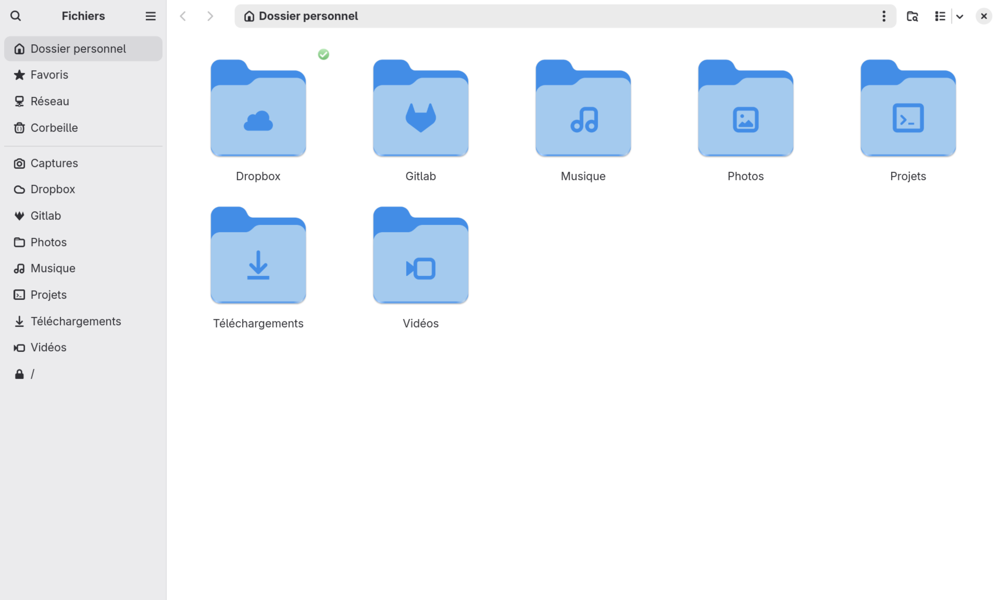

# 7 — GNOME — interface

[Accueil](../README.md) · [Précédent](06-network.md) · [Suivant](08-gnome-extensions.md)

> **Dans ce chapitre :** rendu des polices, échelle, thème visuel, session et alimentation, trousseau, permissions et organisation des lanceurs GNOME.

- [7.2 Régler l'échelle (HiDPI)](#72--régler-léchelle-hidpi)
- [7.3 Fond d'écran, thème de curseurs et GDM](#73--fond-décran-thème-de-curseurs-et-gdm)
- [7.4 Importer et activer le profil couleur de l'écran](#74--importer-et-activer-le-profil-couleur-de-lécran)
- [7.5 Fonctions expérimentales de Mutter et Xwayland au repos](#75--fonctions-expérimentales-de-mutter-et-xwayland-au-repos)
- [7.6 Actions de session, rappels et libellé du profil énergétique (menu d'alimentation)](#76--actions-de-session-rappels-et-libellé-du-profil-énergétique-menu-dalimentation)
- [7.7 Bouton d'alimentation, capot et veille (suspension)](#77--bouton-dalimentation-capot-et-veille-suspension)
- [7.8 Modifier le mot de passe du trousseau](#78--modifier-le-mot-de-passe-du-trousseau)
- [7.9 Régler temporairement les permissions avec malcontent](#79--régler-temporairement-les-permissions-avec-malcontent)
- [7.10 Renommer et organiser les lanceurs (Overview)](#710--renommer-et-organiser-les-lanceurs-overview)
- [7.11 Raccourcis clavier](#711--raccourcis-clavier)
- [7.12 Désactiver les autostarts inutilisés](#712--désactiver-les-autostarts-inutilisés)
- [7.13 Setup d’icônes et dossiers GNOME](#713--setup-dicônes-et-dossiers-gnome)

## 7.2 — Régler l'échelle (HiDPI)

Dans les paramètres d'affichage, choisir une mise à l'échelle **125 %**.

Le masquage des dossiers Nautilus (Modèles, Bureau, fichiers de fond d'écran) et la personnalisation des icônes de dossiers sont traités dans [Nautilus — workflow](09-nautilus-workflow.md#93--masquer-des-dossiers-et-personnaliser-les-icônes).

Pour prévisualiser rapidement les fichiers dans Nautilus avec la barre d’espace, installer **GNOME Sushi** (`sushi`). L’installation est documentée dans [10 — Logiciels](10-logiciels.md#101--logiciels-à-installer). Sushi n’est pas à inclure dans la liste des paquets optionnels à supprimer.

## 7.3 — Fond d'écran, thème de curseurs et GDM

Installer le [fond d'écran Fedora 34 nocturne](https://fedoraproject.org/w/uploads/d/de/F34_default_wallpaper_night.jpg), ou le fond **cosmos_dark_blue** du dépôt.

Pour le curseur, utiliser la variante **Phinger NO LEFT Light** du [projet Phinger Cursors](https://github.com/phisch/phinger-cursors/releases). Placer le dossier du thème dans `/usr/share/icons/` ; vérifier son nom réel, attendu ici comme `phinger-cursors-light`.

Dans dconf-editor, régler la taille sur **32** :

```text
org/gnome/desktop/interface/cursor-size
```

Appliquer le thème au compte GDM :

```fish
sudo -u gdm dbus-launch gsettings set org.gnome.desktop.interface cursor-theme phinger-cursors-light
```

Utiliser ensuite **GDM Settings**, notamment pour le fond d'écran de connexion, et importer le fichier **`gdm-settings.ini`** du dépôt. Une fois les réglages effectués et le fond personnalisé réappliqué, le paquet de cet outil peut être retiré avec le script [`gdm-settings-nettoyer`](../Ressources/Scripts/gdm-settings-nettoyer).

Le script conserve le fichier `gnome-shell-theme.gresource` personnalisé et les réglages dconf de GDM. Il supprime le paquet `gdm-settings` avec ses dépendances orphelines, le thème de travail `/usr/local/share/themes/default-pure` et la sauvegarde `gnome-shell-theme.gresource.default`. Il vérifie d'abord que le gresource actuellement installé diffère bien de l'original enregistré dans la base pacman ; il refuse aussi d'agir si cette empreinte ne peut pas être déterminée.

**Procédure :** lancer d'abord une simulation, vérifier les opérations annoncées, puis exécuter le script sans option :

```fish
bash Ressources/Scripts/gdm-settings-nettoyer --simulation
bash Ressources/Scripts/gdm-settings-nettoyer
```

Le script utilise `sudo` pour les opérations système. Il ne faut le lancer qu'après avoir réappliqué et vérifié le fond GDM personnalisé. Pour revenir ultérieurement à l'écran GDM d'origine, réinstaller `gnome-shell` :

```fish
sudo pacman -S gnome-shell
```

## 7.4 — Importer et activer le profil couleur de l'écran

Importer depuis le repo le profil **ICM/ICC de l'écran** dans **Paramètres GNOME → Couleur**, l'associer à l'écran intégré puis l'activer comme profil utilisé.

## 7.5 — Fonctions expérimentales de Mutter et Xwayland au repos

Sous GNOME 51, les fonctions expérimentales de Mutter ne sont plus dans `org.gnome.mutter experimental-features` (clé supprimée) mais dans un schéma séparé, `org.gnome.mutter.experimental`. Elles restent éditables dans **dconf-editor**. Les anciennes options `scale-monitor-framebuffer` et `native-scaling` n'existent plus dans ce schéma.

### Fermer Xwayland quand aucune application X11 ne tourne

Activer la fermeture automatique de Xwayland (nécessite une reconnexion de session) :

```fish
gsettings set org.gnome.mutter.experimental autoclose-xwayland true
```

Xwayland est alors lancé par Mutter avec `-terminate 10` : il doit s'arrêter 10 secondes après le départ du dernier client X11, puis redémarrer à la demande au lancement d'une application X11.

**Constat sur ce setup :** même avec ce réglage à `true`, Xwayland restait en mémoire (environ 77 Mo) pendant toute la session. Deux clients X11 le retiennent :

- **`gsd-xsettings`** (paquet `gnome-settings-daemon`) transmet aux applications X11 l'échelle, les polices et le thème du curseur. Son service utilisateur est relancé par la cible de session à chaque démarrage de Xwayland.
- **`mutter-x11-frames`**, lancé directement par GNOME Shell avec Xwayland (ce n'est pas un service systemd : il n'y a rien à masquer), ne quitte que lorsqu'**une fenêtre X11 se ferme**. Si aucune fenêtre X11 n'a jamais été ouverte, il reste connecté et Xwayland aussi.

`ibus-x11` ne bloque pas l'arrêt. Ne pas désinstaller `gnome-settings-daemon` ni `ibus`, requis par GNOME Shell.

#### Étape 1 — masquer le service XSettings

```fish
systemctl --user mask org.gnome.SettingsDaemon.XSettings.service
```

Seul, ce masquage ne suffit pas : Xwayland démarre à l'ouverture de session et `mutter-x11-frames` le retient.

#### Étape 2 — fermer une fenêtre X11 fictive à chaque ouverture de session

Le script [`fermer-xwayland`](../Ressources/Scripts/fermer-xwayland) attend que `mutter-x11-frames` soit lancé (30 s au plus), patiente 5 s, crée une fenêtre X11 de 1×1 pixel pendant 0,3 s, puis la détruit. `mutter-x11-frames` quitte alors, et Xwayland s'arrête de lui-même 10 secondes plus tard. Si Xwayland est toujours là après 20 s, il recommence (4 essais au plus) puis abandonne, par exemple si une vraie application X11 tourne. Xwayland redémarre à la demande si une application X11 est lancée plus tard. Le script écrit son résultat dans le journal :

```fish
journalctl --user -b | grep fermer-xwayland
```

La fenêtre est de type **`override-redirect`** : GNOME ne la gère pas, elle n'est ni activée ni encadrée. Une fenêtre ordinaire (testée d'abord avec GTK) est activée à son ouverture, ce qui fait sortir de la vue d'ensemble affichée au démarrage, puis y ramène à sa fermeture. Le script n'utilise que Python et la bibliothèque `libX11` (déjà présentes, sans GTK) ; il consomme environ 0,04 s de processeur, une fois par session, sans retarder l'affichage du bureau.

Depuis la racine du dépôt :

```fish
mkdir -p ~/.local/bin ~/.config/autostart
cp Ressources/Scripts/fermer-xwayland ~/.local/bin/fermer-xwayland
chmod +x ~/.local/bin/fermer-xwayland
printf '[Desktop Entry]\nType=Application\nName=Fermer Xwayland\nComment=Ferme Xwayland après l'"'"'ouverture de session si aucune application X11 ne tourne\nExec=%s/.local/bin/fermer-xwayland\nTerminal=false\nNoDisplay=true\nX-GNOME-Autostart-enabled=true\n' $HOME > ~/.config/autostart/fermer-xwayland.desktop
```

Se reconnecter, patienter une trentaine de secondes (le script attend 5 s, puis Xwayland met 10 s à se fermer), puis contrôler :

```fish
pgrep -a Xwayland    # ne doit rien afficher en l'absence d'application X11
```

**Vérifications faites sur ce setup :** sans le script, Xwayland reste présent indéfiniment (plus de 60 s sans changement) ; avec le script, il disparaît environ 10 s après la fenêtre fictive, GNOME Shell reste stable, et une application X11 lancée ensuite (`GDK_BACKEND=x11 gnome-calculator`) redémarre Xwayland à la demande.

**Contreparties :**

- Sans `gsd-xsettings`, une application X11 lancée plus tard (Wine, ancien AppImage) peut s'afficher avec une mauvaise échelle, une mauvaise police ou un curseur par défaut. Ce setup n'utilise aucune application X11.
- Le mécanisme dépend du comportement de Mutter sous GNOME 51 (`mutter-x11-frames` quitte à la fermeture d'une fenêtre X11). À revérifier avec `pgrep -a Xwayland` après une mise à jour de Mutter ou de GNOME Shell.

**Annuler :**

```fish
rm ~/.config/autostart/fermer-xwayland.desktop ~/.local/bin/fermer-xwayland
systemctl --user unmask org.gnome.SettingsDaemon.XSettings.service
```

Le masquage figure aussi dans la liste des services utilisateur masqués : [Allégement système](02-system-cleanup.md#24--masquer-les-services-système-et-utilisateur-inutilisés).

## 7.6 — Actions de session, rappels et libellé du profil énergétique (menu d'alimentation)

Afficher l'action de fermeture de session dans GNOME 50 :

```fish
gsettings set org.gnome.shell always-show-log-out true
```

Le mémo propose également cette clé pour les boutons de redémarrage et d'arrêt à l'écran de connexion :

```fish
gsettings set org.gnome.login-screen disable-restart-buttons false
```

Une écriture depuis la session utilisateur ne garantit pas à elle seule l'application à la session GDM ; vérifier le résultat sur l'écran de connexion.

Désactiver le rappel de don GNOME si la clé existe dans la version installée :

```fish
gsettings set org.gnome.settings-daemon.plugins.housekeeping donation-reminder-enabled false
```

### Réglages rapides avec Quick Settings

L’extension maison **Quick Settings** remplace **Focus & Boutons** et **Battery Time Compact — Ogu**. Elle reprend les personnalisations du panneau des réglages rapides et y réunit l’affichage compact de la batterie : autonomie, pourcentage et puissance instantanée en watts.

Voir [Extensions GNOME — Quick Settings](08-gnome-extensions.md#87--quick-settings), [Applications Vibe Coded — Quick Settings](11-applications-vibe-coded.md#1117--quick-settings) et [son dossier](../Ressources/Applis%20vibe%20codées%20en%20Libadwaita/Extensions%20GNOME/Quick%20Settings/). Pour les widgets de la barre supérieure et du menu de l’horloge, voir [Widget Topbar](../Ressources/Applis%20vibe%20codées%20en%20Libadwaita/Extensions%20GNOME/Widget%20Topbar/).

## 7.7 — Bouton d'alimentation, capot et veille (suspension)

Éditer la configuration de logind :

```fish
sudoedit /etc/systemd/logind.conf
```

Dans `[Login]`, régler :

```ini
HandlePowerKey=suspend
HandlePowerKeyLongPress=poweroff
HandleLidSwitch=suspend
HandleLidSwitchExternalPower=suspend
```

Appliquer au prochain redémarrage, puis tester le bouton d'alimentation et la fermeture du capot sur secteur et sur batterie.

Désactiver l'ajustement automatique de luminosité :

```fish
gsettings set org.gnome.settings-daemon.plugins.power ambient-enabled false
```

Dans les paramètres d'alimentation GNOME, régler ensuite le délai avant mise en veille à **600 secondes**, soit **10 minutes**, pour le mode d'alimentation souhaité.

## 7.8 — Modifier le mot de passe du trousseau

Dans **Seahorse**, modifier le mot de passe du trousseau concerné et laisser les champs du nouveau mot de passe vides si c'est le comportement souhaité. Reconnecter ensuite le compte Google dans GNOME si nécessaire.

Cette opération concerne le **trousseau de mots de passe**, pas le mot de passe du compte Linux ni l'activation d'une connexion automatique. Un trousseau sans mot de passe n'a plus cette protection de ses secrets sur disque.

## 7.9 — Régler temporairement les permissions avec malcontent

Installer temporairement `malcontent` pour accéder aux réglages d'applications correspondants dans GNOME Control Center :

```fish
sudo pacman -S malcontent
```

Effectuer les réglages voulus, puis retirer le paquet si cette interface n'est plus nécessaire :

```fish
sudo pacman -Rns malcontent
```

## 7.10 — Renommer et organiser les lanceurs (Overview)

Avec **Menu Principal / l'éditeur de menus**, renommer les applications dans la vue d'ensemble et masquer les lanceurs inutiles pour viser une seule page d'applications.

Remplacer également l'icône de Ptyxis par celle de [GNOME Terminal](https://upload.wikimedia.org/wikipedia/commons/d/da/GNOME_Terminal_icon_2019.svg).

### Setup d’icônes et de dossiers

Utiliser ce setup d’icônes et de dossiers.

<p align="center"></p>

## 7.11 — Raccourcis clavier

Dans les paramètres GNOME, affecter :

- La touche **Copilot** à Ptyxis (voir [Shell & terminal](12-shell-terminal.md)).
- **Ctrl+Alt+Suppr** à Ressources.

## 7.12 — Désactiver les autostarts inutilisés

Deux entrées sont visées : le bus d'accessibilité et les notifications Evolution.

Ne pas toucher aux fichiers de `/etc/xdg/autostart/` : un paquet peut les recréer. Placer à la place, dans le dossier utilisateur, un fichier de même nom avec `Hidden=true`, qui neutralise l'entrée système et qu'aucune mise à jour ne remplace :

```fish
mkdir -p ~/.config/autostart
printf '[Desktop Entry]\nType=Application\nHidden=true\n' > ~/.config/autostart/at-spi-dbus-bus.desktop
printf '[Desktop Entry]\nType=Application\nHidden=true\n' > ~/.config/autostart/org.gnome.Evolution-alarm-notify.desktop
```

Les changements sont pris en compte à la prochaine ouverture de session. Pour arrêter tout de suite le processus d'Evolution déjà lancé : `pkill -f evolution-alarm-notify`. Ne pas confondre ces entrées avec les services utilisateur masqués dans [Allégement système](02-system-cleanup.md#24--masquer-les-services-système-et-utilisateur-inutilisés).

## 7.14 — Miniatures vidéo Nautilus sans effet pellicule

Le réglage **Nautilus sans pellicule** supprime la décoration `filmholes` des vignettes vidéo en utilisant `G_RESOURCE_OVERLAYS`. Il est facultatif, réversible et ne modifie pas les fichiers système. Le script et sa sauvegarde sont documentés dans [Nautilus — workflow, section 9.7](09-nautilus-workflow.md#97--supprimer-leffet-pellicule-des-vignettes-vidéo).

## 7.13 — Setup d’icônes et dossiers GNOME

Utiliser ce setup d’icônes d’applications et de dossiers afin de conserver une interface GNOME / Adwaita cohérente.

<p align="center">
  
</p>

### Iconostase — icônes, dossiers et lanceurs

**Iconostase** est l’application GNOME du setup dédiée à la gestion des icônes des applications installées, à la personnalisation des dossiers et à l’édition des lanceurs `.desktop`.

Le dossier [Iconostase](../Ressources/Applis%20vibe%20codées%20en%20Libadwaita/04-Bureau-et-personnalisation/Iconostase/) regroupe son paquet, ses sources et son README. La procédure de [refonte des icônes et de restauration de la sauvegarde](../Ressources/Applis%20vibe%20codées%20en%20Libadwaita/04-Bureau-et-personnalisation/Iconostase/README.md#circuit-de-refonte-dicones) décrit aussi le kit qui réapplique les icônes aux dossiers de cours synchronisés dans Dropbox.

---

[Accueil](../README.md) · [Précédent](06-network.md) · [Suivant](08-gnome-extensions.md)
