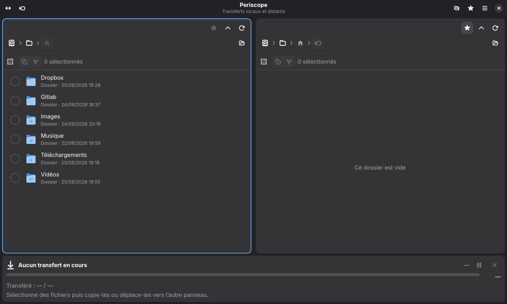
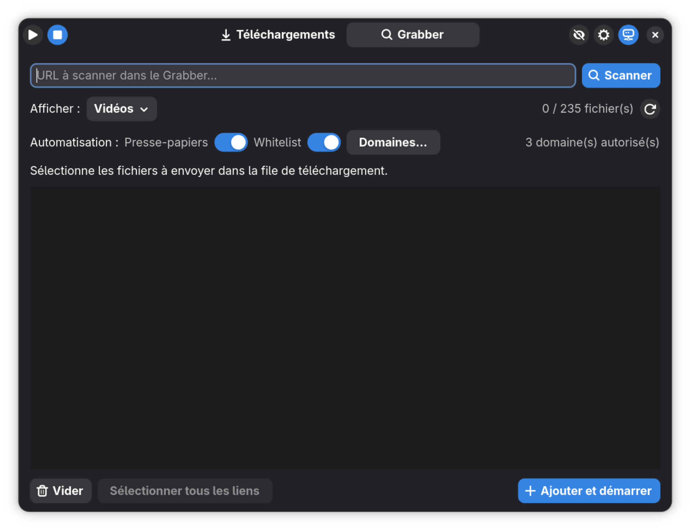
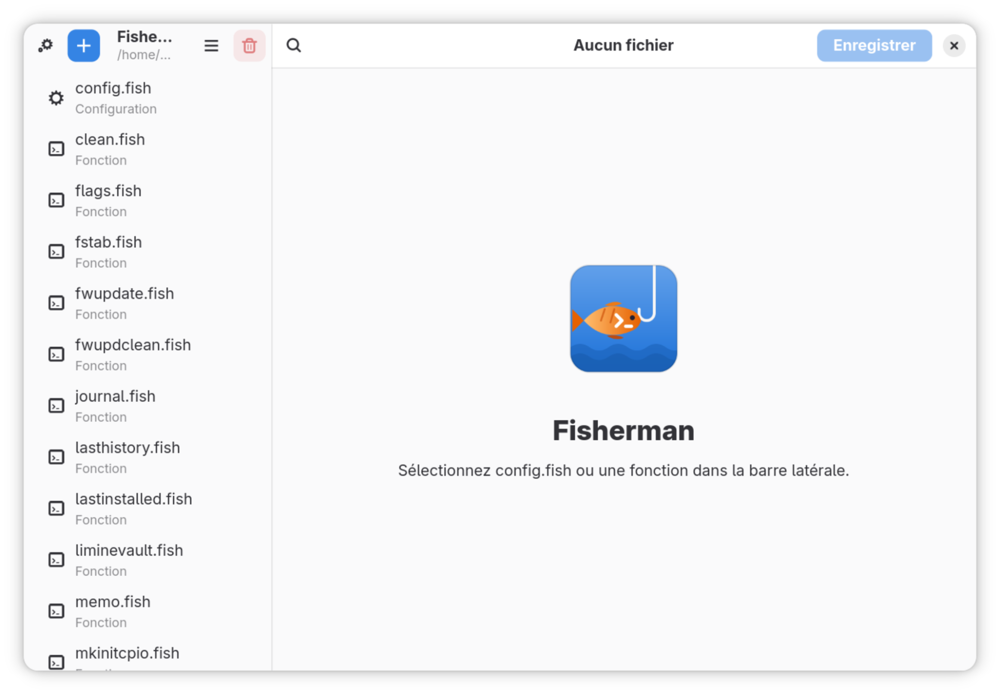
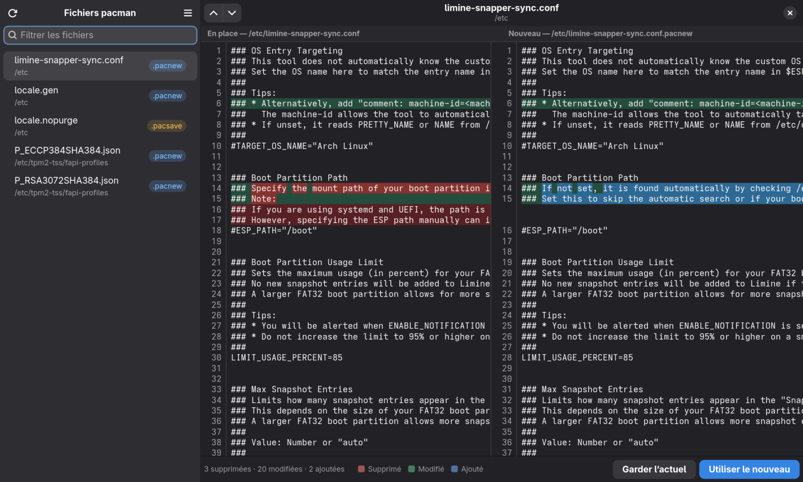
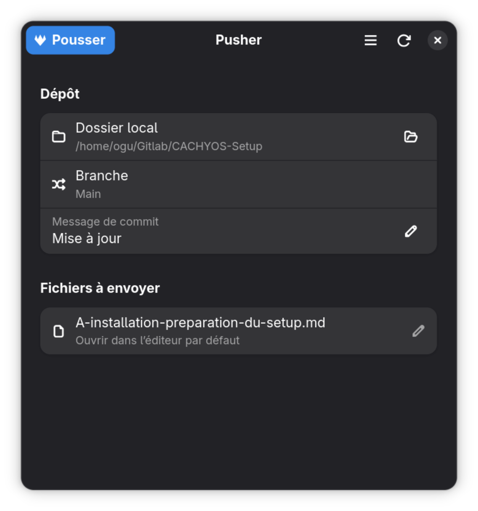
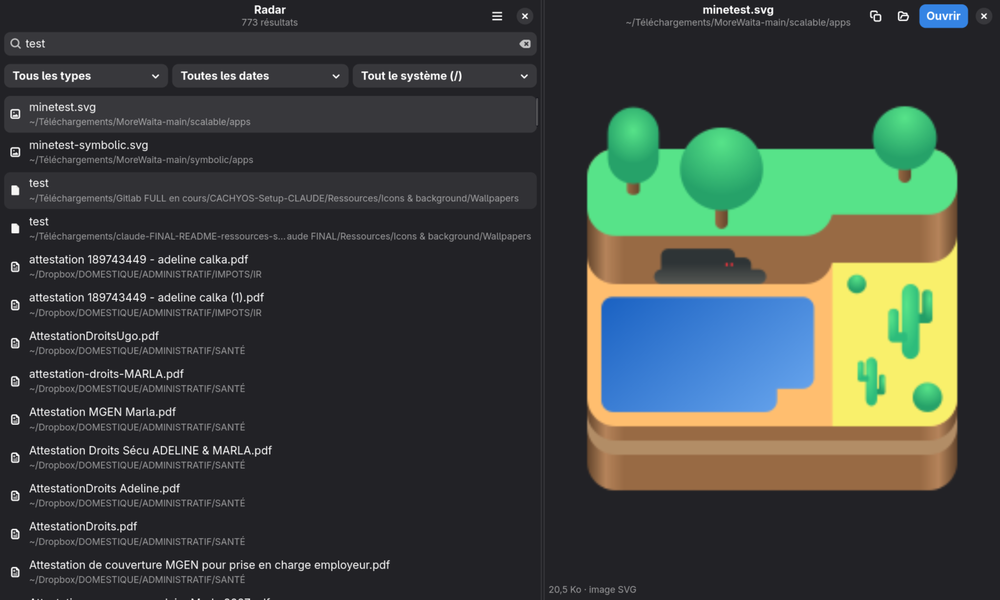
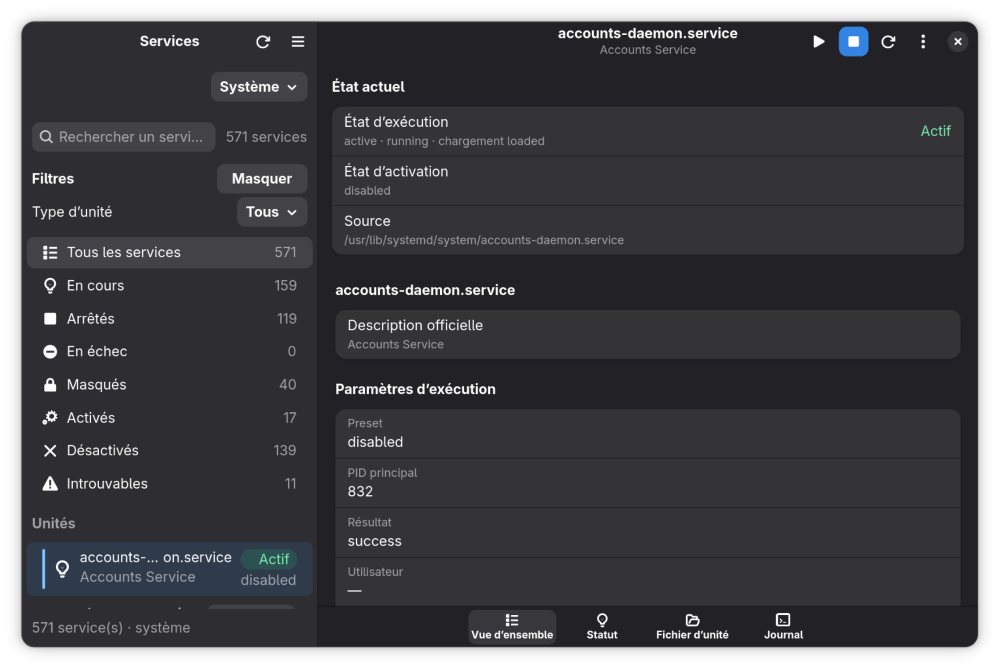
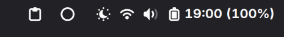

# 11 — Applications Vibe Coded

[Accueil](../README.md) · [Précédent](10-logiciels.md) · [Suivant](12-shell-terminal.md)

> **Dans ce chapitre :** applications personnelles développées avec l'aide du Vibe Coding, principalement en GTK4/libadwaita, dont l’interface native **Perceptron** pour OpenCode, le lecteur musical **Semitone**, **Iconostase**, le gestionnaire de fichiers **Fret** et son compagnon Android TV **Quai**, ainsi que les extensions GNOME maison **Quick Settings**, **Widget Topbar**, **Session Keeper**, **Power Total** et **UI Management**.

**Portage upstream adapté :** Mail (`mail-postcard`) est compilé avec Claude depuis Postcard. Ses fonctions et la procédure d’installation sont décrites dans [10.1.4 — Messagerie : Mail](10-logiciels.md#1014--messagerie--mail).

## Organisation des ressources

Les dossiers sont classés par usage principal. Les extensions GNOME Shell restent regroupées dans [Extensions GNOME](../Ressources/Applis%20vibe%20codées%20en%20Libadwaita/Extensions%20GNOME/).

- **01 — Multimédia** : Amplifaya, Chihito, Decibel, Disquaire, SPECTACLE, Semitone, Polaroid.
- **02 — Bureautique et rédaction** : Alexandrie, Casier, Grimoire, Grille, Dactylo, Maquette.
- **03 — Fichiers et téléchargements** : Fret, Quai, Grabber, Nautilus Bookmark Icons, Thumbnailer Sushi.
- **04 — Bureau et personnalisation** : Extension Manager, Iconostase.
- **05 — Système et utilitaires** : dconf-editor GTK4, Fisherman, Pacto, Perceptron, Pusher, Radar, Sismographe, Snapper GTK4, systemd-gui, Vidange.

## 01 — Multimédia

- [11.22 — Amplifaya — moteur headless et interface](#1122--amplifaya--moteur-headless-et-interface)
- [11.7 — Decibel](#117--decibel)
- [11.32 — Polaroid](#1132--polaroid)
- [11.27 — Disquaire](#1127--disquaire)
- [11.29 — Semitone](#1129--semitone)
- [11.35 — Chihito](#1135--chihito)
- [11.36 — SPECTACLE](#1136--spectacle)

## 02 — Bureautique et rédaction

- [11.3 — Grimoire](#113--grimoire)
- [11.23 — Grille](#1123--grille)
- [11.24 — Dactylo](#1124--dactylo)
- [11.30 — Alexandrie](#1130--alexandrie)
- [11.34 — Maquette](#1134--maquette)
- [11.38 — Casier](#1138--casier)


## 03 — Fichiers et téléchargements

- [11.4 — Fret](#114--fret)
- [11.2 — Grabber](#112--grabber)
- [11.12 — Nautilus Bookmark Icons](#1112--nautilus-bookmark-icons)
- [11.37 — Quai — serveur FTP compagnon pour Fret](#1137--quai--serveur-ftp-compagnon-pour-fret)
- [11.31 — Thumbnailer Sushi](#1131--thumbnailer-sushi)

### 11.31 — Thumbnailer Sushi

**Thumbnailer Sushi** est maintenant livré sous forme de deux paquets Arch, accompagnés d’un installeur :

- `sushi-thumbnailer-docs-extra-1.7.0-1-any.pkg.tar.zst` : aperçus Sushi des documents, PDF simplifiés et archives, miniatures de documents et fichiers texte/code.
- `nautilus-vignettes-arrondies-sushi-1.0.0-1-x86_64.pkg.tar.zst` : rayon de coins Nautilus/Adwaita sur toutes les miniatures GNOME dans Nautilus, photos et PDF compris.
- `installer.sh` : installe les paquets disponibles, arrête proprement Nautilus et Sushi, purge automatiquement le cache de miniatures puis relance Nautilus s’il était actif.

Fonctions principales :

- **Aperçus Sushi** : DOCX, ODT, RTF, Markdown, PDF avec rendu simplifié, PPTX/ODP et XLSX/ODS.
- **Archives** : ZIP, TAR et variantes compressées, 7z, RAR et paquets Arch, listés sans extraction.
- **Miniatures** : les fichiers texte et code disposent d’un aperçu avec un bandeau indiquant leur nature ; les documents bureautiques, présentations et tableurs utilisent des fiches adaptées.
- **Coins arrondis** : toutes les miniatures GNOME de Nautilus suivent le rayon Nautilus/Adwaita lorsque le paquet complémentaire est installé.

La conversion s’exécute dans un processus Python séparé sans shell ; l’aperçu HTML applique une CSP restrictive et désactive JavaScript. Le rendu est destiné à la consultation rapide : les mises en page complexes et les formats Office binaires anciens (`.doc`, `.xls`, `.ppt`) ne sont pas pris en charge.

### Installation / mise à jour

Les deux paquets et le script sont présents dans [le dossier Thumbnailer Sushi](../Ressources/Applis%20vibe%20codées%20en%20Libadwaita/03-Fichiers-et-telechargements/Thumbnailer%20Sushi/). Depuis ce dossier, lancer sans sudo :

```bash
sh ./installer.sh
```

L’installeur purge lui-même le cache de miniatures : aucune commande de nettoyage séparée n’est requise. Pour simuler les opérations sans les appliquer, exécuter `sh ./installer.sh -s`.

Pour l’utilisation dans le workflow Nautilus, voir [9.7 — Aperçu et miniatures avec Sushi](09-nautilus-workflow.md#97--aperçu-et-miniatures-avec-sushi).

---

## 04 — Bureau et personnalisation

- [11.21 — Extension Manager](#1121--extension-manager)
- [11.25 — Iconostase](#1125--iconostase)

## 05 — Système et utilitaires

- [11.28 — Vidange](#1128--vidange)
- [11.33 — Perceptron — interface GNOME pour OpenCode](#1133--perceptron--interface-gnome-pour-opencode)
- [11.15 — dconf-editor GTK4](#1115--dconf-editor-gtk4)
- [11.8 — Fisherman](#118--fisherman)
- [11.9 — Pacto](#119--pacto)
- [11.11 — Pusher](#1111--pusher)
- [11.10 — Radar](#1110--radar)
- [11.6 — systemd](#116--systemd)
- [11.13 — Sismographe](#1113--sismographe)
- [11.14 — Snapper GTK4](#1114--snapper-gtk4)

## Extensions GNOME Shell

- [11.1 — Always on top, always on top](#111--always-on-top-always-on-top)
- [11.16 — Session Keeper](#1116--session-keeper)
- [11.17 — Quick Settings](#1117--quick-settings)
- [11.18 — Widget Topbar](#1118--widget-topbar)
- [11.19 — Power Total](#1119--power-total)
- [11.20 — UI Management](#1120--ui-management)

## 01 — Multimédia

### 11.22 — Amplifaya — moteur audio PipeWire

**Amplifaya 0.5.1** est un moteur audio PipeWire basé sur le cœur DSP de JamesDSP, sans interface graphique au démarrage et sans Qt. Le profil ClearPenguin est chargé par défaut ; une interface GTK4/libadwaita reste disponible à la demande avec `amplifaya-gui`.

Depuis la 0.5.0, PipeWire charge directement le traitement et WirePlumber insère le filtre devant la sortie audio. Le démon `amplifayad` et le service utilisateur `amplifaya.service` ont été supprimés. La commande `amplifayactl` pilote directement le traitement et conserve son état dans `~/.config/amplifaya/state.conf`.

La 0.5.1 ajoute la bascule automatique vers le son natif lors de la détection d’un casque, puis le retour du traitement sur les haut-parleurs, sans service séparé. La marge avant traitement est réglable de 0 à 6 dB (0 par défaut). La détection de la prise jack physique reste à vérifier en session réelle.

Commandes principales : `amplifayactl status`, `test`, `ab`, `bypass on|off`, `bass on|off`, `wide on|off`, `marge 0…6`, `presets` et `preset NOM`. Lance un morceau pendant `test` ou `ab`. Désactive JamesDSP ou EasyEffects pour éviter un double traitement.

**Mise à jour depuis 0.4.x :** mets la musique en pause, installe le nouveau paquet, désactive l’ancien service s’il existe, puis redémarre PipeWire et WirePlumber. La version 0.4.0 pouvait forcer la carte son à 100 % : baisse le volume avant de reprendre la lecture.

```fish
sudo pacman -U ./amplifaya-full-0.5.1-1-x86_64.pkg.tar.zst
systemctl --user disable --now amplifaya.service 2>/dev/null
systemctl --user restart pipewire wireplumber pipewire-pulse
amplifayactl status
amplifayactl test
```

Le paquet moteur seul est `amplifaya-0.5.1-1-x86_64.pkg.tar.zst`. Le dépôt contient encore l’archive 0.4.0 ; ajoute manuellement le paquet 0.5.1 dans le dossier [Amplifaya](../Ressources/Applis%20vibe%20codées%20en%20Libadwaita/01-Multimedia/Amplifaya/).

- Le moteur utilise environ 2 Mo de mémoire ; l’interface environ 100 Mo lorsqu’elle est ouverte.
- Pas de Bluetooth ; tous les effets de JamesDSP ne sont pas repris.


### Vérification après installation

Lance un morceau (MP3 ou autre) et laisse-le jouer pendant toute la vérification. Ces commandes contrôlent le volume matériel, le volume de la sortie Amplifaya, la sortie par défaut, le journal du moteur et enfin le traitement audio réel :

```fish
pactl get-sink-volume alsa_output.pci-0000_63_00.6.analog-stereo
pactl get-sink-volume amplifaya
pactl get-default-sink
journalctl --user -u amplifaya -b --no-pager | grep carte
amplifayactl test
amplifayactl ab
```

Résultat attendu sur la configuration testée : la carte physique est à **100 %**, la sortie par défaut est `amplifaya`, le journal indique que la carte a été mise à 100 % et que le volume Amplifaya a été ajusté. `amplifayactl test` doit confirmer que le son est modifié. `amplifayactl ab` alterne quatre fois entre le traitement Amplifaya et le son d'origine, puis restaure l'état initial. Les noms de sink peuvent varier d'une machine à l'autre : si la carte physique n'a pas le nom indiqué, repère son nom exact avec `pactl list short sinks` et adapte la première commande.

L'interface est incluse dans ce même paquet et peut être ouverte à la demande :

```fish
amplifaya-gui
```

Commandes utiles : `amplifayactl test`, `amplifayactl ab`, `amplifayactl bypass on|off`, `amplifayactl bass on|off`, `amplifayactl wide on|off`, `amplifayactl outputs`, `amplifayactl output NOM`, `amplifayactl stop` et `amplifayactl start`. Journaux : `journalctl --user -u amplifaya.service -b`.


### 11.32 — Polaroid

**Polaroid** est une visionneuse d’images GNOME basée sur un fork de [Loupe](https://gitlab.gnome.org/GNOME/loupe), écrite en Rust avec GTK4 et libadwaita. Elle remplace le paquet GNOME `loupe` dans ce setup et ajoute un éditeur pour annoter les captures d’écran.

Fonctions principales :

- **Visionneuse** : zoom, navigation entre les images d’un dossier, propriétés et impression.
- **Annotations** : flèches, cercles, rectangles, traits, dessin libre et étiquettes de texte, en six couleurs.
- **Étiquettes de texte** : déplacement à la souris et modification par double-clic.
- **Retouches** : recadrage, rotation et retournement.
- **Historique** : annuler avec `Ctrl+Z`, rétablir avec `Ctrl+Maj+Z`.

#### Flux de travail avec les captures d’écran

1. Faire une capture d’écran GNOME et cliquer sur sa notification pour l’ouvrir dans Polaroid.
2. Cliquer sur le bouton de recadrage pour ouvrir l’éditeur, puis ajouter les annotations.
3. Cliquer sur **Remplacer** : le fichier est remplacé par l’image annotée, celle-ci est copiée dans le presse-papiers et l’original est conservé sept jours dans `~/.cache/polaroid/originals/`.

#### Installation et remplacement de Loupe

Le paquet Arch compilé sera ajouté manuellement dans [le dossier Polaroid](../Ressources/Applis%20vibe%20codées%20en%20Libadwaita/01-Multimedia/Polaroid/). Désinstaller d’abord Loupe, puis installer le paquet local depuis ce dossier :

```fish
sudo pacman -Rns loupe
sudo pacman -U ./polaroid-51.1.0-1-x86_64.pkg.tar.zst
```

Lancer ensuite Polaroid depuis la grille d’applications GNOME ou avec `polaroid`.

Licence : **GPL-3.0-or-later**, comme Loupe.

---

### 11.7 — Decibel

Fork personnalisé de **Decibels**, le lecteur audio GNOME. Les modifications apportées permettent notamment de supprimer un titre avec `Suppr` et d'éviter l'ouverture d'une seconde fenêtre lorsqu'un fichier audio est ouvert pendant une lecture : le nouveau morceau remplace celui de la fenêtre existante.

**Paquet fourni : `decibel-49.6.1-1-any.pkg.tar.zst`.**

### Installation

```fish
sudo pacman -U ./decibel-49.6.1-1-any.pkg.tar.zst
```

### Désinstallation

```fish
sudo pacman -Rns decibel
```

### Capture

Une capture de l'interface de Decibel n'a pas été fournie dans cet envoi. Elle pourra être ajoutée sous `../Ressources/screenshots/vibe-coded/decibel.png`.

---

### 11.27 — Disquaire

**Disquaire 1.7.3** est un éditeur GTK4/libadwaita de tags MP3 et FLAC pour GNOME. Il conserve sept champs — artiste, titre, album, année, genre, pochette et paroles — et supprime les autres tags lors du nettoyage automatique ou à l’enregistrement.

La version documentée propose notamment le nettoyage automatique, la normalisation des dates et pochettes, la recherche globale avec index en cache, l’édition groupée, la mise en forme artiste/titre, la réserve de pochettes par genre, la recherche de paroles LRCLIB avec traitement en lot, la recherche floue de doublons, la conversion FLAC vers MP3 320 kb/s et l’annulation des dernières opérations.

Les modifications de pochette, la mise en forme et les valeurs récupérées en ligne sont enregistrées directement. Les modifications manuelles dans les champs restent en attente, signalées par un point bleu. Le nettoyage automatique peut être désactivé dans les préférences.

**Installation du paquet 1.7.3** — le fichier `disquaire-1.7.3-1-any.pkg.tar.zst` est présent dans le dossier Disquaire :

~~~fish
sudo pacman -U "Ressources/Applis vibe codées en Libadwaita/01-Multimedia/Disquaire/disquaire-1.7.3-1-any.pkg.tar.zst"
~~~

Le dossier contient le paquet 1.7.3 (l’ancienne archive 1.5.2 et l’intermédiaire 1.7.1 remplacés).


---

### 11.29 — Semitone

**Semitone** est un lecteur musical GTK4/libadwaita écrit en Vala, fork de [Gapless](https://gitlab.com/Lalaggi/semitone/-/tree/main) (dans la lignée de G4Music). Le fork est compilé avec **Claude** pour ce setup et remplace l’installation du paquet `gapless` depuis l’AUR.

Fonctions annoncées par le projet :

- Lecture sans blanc entre les morceaux (*gapless*) via GStreamer.
- Paroles synchronisées au format LRC, avec 13 fournisseurs.
- Égaliseur à six bandes et prise en charge de ReplayGain.
- Gestion des playlists et intégration MPRIS avec GNOME.
- Exposition du chemin du fichier local pour permettre « Ouvrir dans Disquaire » et « Afficher dans Fichiers » depuis Widget Topbar.
- Identifiant de morceau pour un positionnement précis dans la barre de progression.
- Signal de changement d’état de l’aléatoire : l’interface suit l’état réel, et sa désactivation restaure le tri antérieur plutôt qu’un tri par titre.
- Exposition du titre suivant, y compris le premier morceau après le dernier avec « Tout répéter ».

Le paquet Arch compilé n’est pas inclus pour le moment : il sera ajouté manuellement dans le dossier [Semitone](../Ressources/Applis%20vibe%20codées%20en%20Libadwaita/01-Multimedia/Semitone/), comme les autres paquets maison. Pour retrouver le lecteur dans le menu de l’horloge et afficher une icône musicale animée tout à gauche de la barre supérieure, voir [Widget Topbar](../Ressources/Applis%20vibe%20codées%20en%20Libadwaita/Extensions%20GNOME/Widget%20Topbar/). Les ajouts MPRIS sont destinés à l’intégration avec [Widget Topbar](../Ressources/Applis%20vibe%20codées%20en%20Libadwaita/Extensions%20GNOME/Widget%20Topbar/). La comparaison effectuée indique que les bibliothèques utilisées sont identiques à celles de l’ancien paquet et que l’interface intégrée est identique octet pour octet. **La nouvelle intégration n’a pas encore été testée en session GNOME Shell.** Une fois le fichier `semitone-*.pkg.tar.zst` copié dans ce dossier, ouvrir un terminal dans ce dossier et installer le paquet :

```fish
set paquets_semitone (find . -maxdepth 1 -type f -name 'semitone*.pkg.tar.zst')
if test (count $paquets_semitone) -eq 1
    sudo pacman -U "$paquets_semitone[1]"
else
    echo 'Conserver un seul paquet Semitone dans ce dossier avant installation.''
end
```

La procédure ci-dessus fonctionne dès qu’un unique paquet `semitone*.pkg.tar.zst` est ajouté dans le dossier Semitone. Aucun paquet compilé n’est actuellement référencé dans le dépôt.


---

### 11.35 — Chihito

**Chihito** est une application d’ambiance de travail dans l’esprit de **Lofi Girl**, destinée à accompagner les sessions de concentration. Son paquet intègre une extension GNOME Shell qui ajoute une bascule de lancement dans les réglages rapides.

**Paquet fourni :** `chihiro-0.6.1-1-any.pkg.tar.zst` (à déposer manuellement dans [le dossier Chihito](../Ressources/Applis%20vibe%20codées%20en%20Libadwaita/01-Multimedia/Chihito/)).

Depuis ce dossier, installer le paquet :

```fish
sudo pacman -U ./chihiro-0.6.1-1-any.pkg.tar.zst
```

Sous Wayland, **se déconnecter puis se reconnecter** : GNOME Shell ne découvre les nouvelles extensions qu’à l’ouverture de session. Activer ensuite l’extension intégrée :

```fish
gnome-extensions enable chihiro-quicksettings-launch-toggle@ogu
```

Voir le [README de Chihito](../Ressources/Applis%20vibe%20codées%20en%20Libadwaita/01-Multimedia/Chihito/README.md).

---

### 11.36 — SPECTACLE

**SPECTACLE** est un lecteur YouTube qui permet de lire les contenus **avec ou sans vidéo**. Il comprend également une fonction nommée **Rideau**.

Le paquet et les éventuelles sources seront ajoutés manuellement dans [le dossier SPECTACLE](../Ressources/Applis%20vibe%20codées%20en%20Libadwaita/01-Multimedia/SPECTACLE/). Les dépendances et la procédure d’installation seront précisées lorsque le README technique sera disponible.

Voir le [README de SPECTACLE](../Ressources/Applis%20vibe%20codées%20en%20Libadwaita/01-Multimedia/SPECTACLE/README.md).

---

## 02 — Bureautique et rédaction

### 11.3 — Grimoire

Éditeur Markdown local GTK4/libadwaita utilisant **GtkSourceView 5** et **WebKitGTK 6**. **Version documentée : 0.3.0.** Il permet de parcourir des dossiers de documents Markdown, d’éditer les fichiers et d’afficher leur rendu.

La version 0.3.0 ajoute les actions sur les notes (renommer, dupliquer, déplacer, afficher dans Fichiers, épingler dans le widget, créer un rendez-vous et supprimer avec annulation pendant 5 secondes), le renommage des dossiers épinglés et l’accès aux notes depuis la recherche GNOME. Les notes épinglées sont également consultables dans le menu de l’horloge GNOME avec [Widget Topbar](../Ressources/Applis%20vibe%20codées%20en%20Libadwaita/Extensions%20GNOME/Widget%20Topbar/) : catégories, recherche, tâches, couleurs, rendez-vous et corbeille, avec le raccourci `Super+Alt+N`. L’icône violette est fournie à toutes les tailles, dock compris.

**Paquet fourni : `grimoire-ogu-0.3.0-1-x86_64.pkg.tar.zst`.**

Pour le widget de notes dans le menu de l'horloge, installer également **Widget Topbar**. Voir les README dédiés de [Grimoire](../Ressources/Applis%20vibe%20codées%20en%20Libadwaita/02-Bureautique-et-redaction/Grimoire/readme_grimoire.md) et de [Widget Topbar](../Ressources/Applis%20vibe%20codées%20en%20Libadwaita/Extensions%20GNOME/Widget%20Topbar/).

### Installation

```fish
sudo pacman -U ./grimoire-ogu-0.3.0-1-x86_64.pkg.tar.zst
grimoire
```

> Si le copier-coller remplace le nom de commande, utiliser simplement `grimoire`.

### Désinstallation

```fish
sudo pacman -Rns grimoire-ogu
```

---

### 11.23 — Grille

**Grille** est une visionneuse simple de fichiers tableurs, codée avec **Claude**.

**Paquet : `grille-0.1.0-1-x86_64.pkg.tar.zst`.** Le paquet n’est pas encore présent dans le dépôt ; il est à ajouter manuellement dans [le dossier Grille](../Ressources/Applis%20vibe%20codées%20en%20Libadwaita/Grille/).

Depuis le dossier contenant le paquet :

```fish
sudo pacman -U ./grille-0.1.0-1-x86_64.pkg.tar.zst
```

Les formats pris en charge et la commande de lancement restent à vérifier avec le paquet installé.

### 11.38 — Casier

**Casier 1.3.0** est une application GTK4/libadwaita en Python destinée à récupérer, identifier, corriger et archiver les devoirs déposés par les élèves. Les élèves envoient leur fichier depuis un lien Dropbox File Request, sans compte Dropbox. Casier rapproche les fichiers des élèves, affiche les rendus, retards et copies manquantes, puis associe chaque copie à une note et une appréciation.

#### Fonctions

- Gestion des classes et import des listes d’élèves (un nom par ligne au format NOM Prénom ou un CSV Nom;Prénom).
- Création de devoirs avec barème, échéance, consignes et document joint ; génération d’une demande de fichiers Dropbox et d’un QR code à partager.
- Synchronisation des dépôts toutes les deux minutes tant que la page du devoir reste ouverte ; attribution manuelle des fichiers non reconnus.
- Correction des PDF, images, vidéos et textes extraits de fichiers Word/ODT, avec note et appréciation par élève.
- Fermeture des dépôts, renommage des copies (NOM_Prénom_Devoir), export CSV des notes et archivage.
- Mode dossier local pour les dépôts provenant d’un dossier Dropbox synchronisé sur le PC.
- Sauvegarde automatique quotidienne de la base, conservation des 30 dernières sauvegardes et restauration depuis l’application.

#### Installation

Le paquet Arch casier-1.3.0-1-any.pkg.tar.zst et l’archive de sources casier-1.3.0-sources.tar.gz sont les livrables de cette version. Les placer dans le dossier Casier, puis installer le paquet depuis ce dossier :

~~~fish
sudo pacman -U ./casier-1.3.0-1-any.pkg.tar.zst
~~~

Dépendances automatiques : python-gobject, python-cairo, python-qrcode, gtk4, libadwaita, poppler-glib, libsoup3 et libsecret. Facultatifs : gst-plugins-good pour l’aperçu vidéo/audio et libheif pour les photos HEIC.

#### Première connexion à Dropbox

Dans Préférences → Dropbox → Connecter, créer une application Scoped access / Full Dropbox dans la console Dropbox. Accorder les permissions account_info.read, files.metadata.read, files.content.read, files.content.write, file_requests.read, file_requests.write, sharing.read et sharing.write, puis saisir l’App key dans Casier. Ouvrir la page d’autorisation, accepter et coller le code fourni. Le jeton est conservé dans le trousseau GNOME. Après l’ajout de permissions, déconnecter puis reconnecter Casier.

#### Données et sauvegardes

- Base : ~/.local/share/casier/casier.db.
- Sauvegardes : ~/.local/share/casier/sauvegardes/ (30 derniers jours).
- Copies récupérées : ~/.local/share/casier/depots/.
- Archives : ~/Documents/Casier/ (emplacement modifiable dans les Préférences).
- Espace Dropbox : Casier/<année>/<classe>/<devoir> et Casier/<année>/<classe>/Consignes/.

La suppression d’un devoir ou d’une classe peut également supprimer les fichiers correspondants dans Dropbox. Le nettoyage d’une année supprime Casier/<année> côté Dropbox, sans effacer les copies et notes déjà récupérées localement. Les fichiers supprimés dans Dropbox restent récupérables 30 jours dans « Fichiers supprimés ».

Pour le guide complet, voir le README de Casier dans le dossier de l’application.

---

### 11.24 — Dactylo

**Dactylo 0.11.0** est un traitement de texte GNOME en Rust, GTK4/libadwaita, basé sur `letters-core` de gtk-office-suite. Il prend en charge DOCX, ODT, Markdown, texte brut, HTML et la lecture/export PDF. Les nouveautés documentées depuis 0.8.0 comprennent un aperçu paginé en direct, l’OCR français (images et PDF scannés), une règle graduée, des commandes de paragraphe plus compactes, la correction orthographique globale, un mode concentration amélioré et des corrections de sélection, de défilement et de copie sur clé USB.

### Nouveautés 0.8.1 à 0.11.0

- **Aperçu en direct** : panneau à droite, F12 pour l’afficher/masquer, rendu différé après la frappe, suivi de la page et du curseur, clic pour positionner le curseur et double-clic pour ouvrir l’outil d’une image, frise, tableau ou cartouche. Largeur mémorisée ; panneau masqué en mode concentration et dans les onglets PDF.
- **OCR en français** : Tesseract reconnaît le texte imprimé d’une image collée, d’un fichier image ou d’un PDF scanné. Le texte peut remplacer l’image collée, être inséré sous une image ou être copié depuis un onglet PDF. Les pages PDF sont traitées avec progression ; une opération OCR s’annule en un seul Ctrl+Z. L’écriture manuscrite et les documents complexes en plusieurs colonnes restent moins bien reconnus.
- **Règle graduée** : Ctrl+R, graduation tous les 0,25 cm, réglage du retrait du paragraphe et lignes repères verticales.
- **Paragraphes et orthographe** : style courant indiqué par l’icône ¶, retrait basculant, boutons dédiés d’alignement à gauche et de centrage ; « Corriger tout le document » applique la première suggestion après confirmation, avec une seule annulation.
- **Mode concentration et interface** : page blanche plein écran, ligne en cours centrée si l’option est activée, entrée/sortie sans perdre la position du curseur. Barre d’outils plus compacte, Annuler/Rétablir à gauche, boutons d’insertion regroupés dans « + » lorsque la fenêtre est étroite.
- **Préférences** : aperçu à droite au démarrage et bouton OCR masquable.
- **Corrections** : la sélection est conservée lors du changement de police, taille ou couleur ; le clic dans la page ne provoque plus de remontée intempestive ; les erreurs d’enregistrement expliquent la cause probable ; la copie sur clé USB passe par des fichiers préparés localement.

### Modèles fournis

Quatre modèles DOCX sont fournis dans l’archive `Modèles de cours en docx (Dactylo).tar.xz` :
- `Cours.docx`
- `Page de garde de séquence.docx`
- `Bac blanc Français.docx`
- `Bac blanc Histoire-Géographie.docx`

L’archive se trouve dans `Ressources/Applis vibe codées en Libadwaita/02-Bureautique-et-redaction/Dactylo/Modeles/`. Après extraction, importer les fichiers DOCX depuis les préférences (`Ctrl+,`). Ils ne sont pas importés automatiquement.

### Installation

Le seul paquet présent dans le dossier est encore l’ancien build Samizdat : `samizdat-0.11.3-1-x86_64.pkg.tar.zst`. Il n’a pas été reconstruit sous le nom Dactylo et ne doit pas être présenté comme un paquet Dactylo. Une nouvelle archive devra être ajoutée après reconstruction réelle, avec les dépendances OCR `tesseract` et `tesseract-data-fra`.


### 11.30 — Alexandrie

**Alexandrie** est une visionneuse simple de Wikipédia en français pour GNOME, développée en GTK 4/libadwaita. Elle est conçue pour préparer des cours d'histoire, de géographie et de littérature : lecture épurée d'articles, collecte d'extraits et export de fiches PDF.

- **Lecture** : onglets, sommaire latéral, aperçu des liens au survol, recherche dans l'article et historique.
- **Repères et lieux** : dates clés extraites de Wikidata (vie, œuvres, événements, fonctions), carte OpenStreetMap et ouverture des lieux cités dans GNOME Cartes.
- **Panier d'extraits** : passages, images, dates, consignes et glossaire ; documents numérotés, à copier dans un traitement de texte ou à exporter en PDF.
- **Favoris** : classement par tags libres.
- **Sources** : Wikipédia (« Encyclopédie »), Vikidia (8–13 ans), Wikisource (« Textes ») et Wikimedia Commons (« Images »). Le Wiktionnaire s'ouvre au double-clic ; les articles proposent aussi « Voir aussi ».

### Installation et lancement

Depuis le dossier des sources, sur Arch Linux ou CachyOS :

```sh
makepkg -si
```

Ou installer le paquet précompilé, une fois ajouté au dossier de l'application :

```sh
sudo pacman -U ./alexandrie-*.pkg.tar.*
```

Vérifier qu'un seul paquet correspond au motif avant l'installation. Pour essayer l'application sans l'installer, depuis les sources :

```sh
./run.sh
```

Le guide complet `docs/GUIDE.md` est fourni avec les sources et couvre les fonctionnalités, raccourcis, préférences et données utilisateur. Les sources et le guide détaillé ne sont pas encore copiés dans ce dépôt ; le paquet compilé sera ajouté manuellement dans `Ressources/Applis vibe codées en Libadwaita/02-Bureautique-et-redaction/Alexandrie/`.

---

## 03 — Fichiers et téléchargements

### 11.4 — Fret

Gestionnaire de fichiers GTK4/libadwaita à deux panneaux, inspiré de Nautilus. Chaque panneau peut afficher un emplacement local ou une URI GVfs telle que FTP, SFTP ou SMB. Les transferts sont effectués directement entre les deux panneaux.

**Paquet fourni : `fret-0.2.0-1-any.pkg.tar.zst`.**



### Installation

```fish
sudo pacman -U ./fret-0.2.0-1-any.pkg.tar.zst
```


Pour SMB, installer au besoin :

```fish
sudo pacman -S --needed gvfs-smb
```

### Désinstallation

```fish
sudo pacman -Rns fret
```
 

### 11.37 — Quai — serveur FTP compagnon pour Fret

**Quai** est une application compagnon pour Android TV : elle démarre en un clic un serveur FTP sur le téléviseur afin de transférer des fichiers entre la TV et l’ordinateur depuis les deux panneaux de **Fret**.

Le serveur utilise le port **2121** par défaut et un mot de passe aléatoire généré au premier lancement. Le nom d’utilisateur est libre ; seul le mot de passe est vérifié. Quai prend en charge la lecture et l’écriture, l’envoi, le téléchargement, la reprise, la création, le renommage et la suppression. Le stockage peut être interne ou correspondre à un disque externe branché à la TV.

Deux tuiles sont installées :

- **Quai** : réglages du serveur, adresse, mot de passe, port, choix du disque et démarrage automatique ;
- **Quai ON/OFF** : interrupteur direct, sans écran de réglages.

Le serveur fonctionne en service de premier plan et affiche son adresse dans une notification. Le démarrage automatique surveille notamment le branchement tardif des disques ; les téléviseurs TCL peuvent toutefois bloquer le lancement automatique des applications installées manuellement. Un arrêt volontaire reste respecté jusqu'au prochain démarrage manuel.

#### Utilisation avec Fret

1. Démarrer le serveur sur la TV avec **Quai ON/OFF** ou depuis **Quai**.
2. Dans l'un des panneaux de Fret, ouvrir la saisie d'emplacement avec `Ctrl+L` et entrer l'adresse affichée, sous la forme `ftp://192.168.1.x:2121`.
3. Saisir un nom d'utilisateur quelconque et le mot de passe affiché dans Quai.

Une réservation d'adresse IP dans la box facilite les connexions répétées. Le dossier [Quai](../Ressources/Applis%20vibe%20codées%20en%20Libadwaita/03-Fichiers-et-telechargements/Quai/) est créé pour accueillir l'APK et sa documentation.

**Sécurité :** FTP transmet le mot de passe et les fichiers en clair. Utiliser Quai uniquement sur le réseau local, ne jamais rediriger son port depuis Internet et arrêter le serveur lorsqu'il n'est pas utilisé. Android TV 6 (API 23) ou supérieur.

---

### 11.2 — Grabber

Frontend GTK4/libadwaita minimaliste pour JDownloader 2. Il permet de récupérer des liens, sélectionner les fichiers utiles, les ajouter à la file de téléchargement et suivre les téléchargements. L'AppImage embarque son propre Java et JDownloader. Une extension complémentaire pour Vivaldi envoie les URL au logiciel via le protocole `grabber://`.

**AppImage fournie : `Grabber.AppImage`.** Le runtime est le runtime officiel AppImage **type 2**, compatible **FUSE 3**. Cette mise à jour du runtime ne modifie pas le code de Grabber. Les sources de référence sont désormais dans `sources/jd_adwaita` ; les anciens dossiers `sources/` et `Grabber-sources/` étaient périmés.



### Installation

Rendre l'AppImage exécutable, puis installer le lanceur GNOME et l'association de protocole :

```fish
chmod +x ./Grabber.AppImage
./Grabber.AppImage --install-desktop
```

L'option `--install-desktop` doit être exécutée une fois depuis l'emplacement définitif de l'AppImage, et de nouveau si celle-ci est déplacée. Elle installe le lanceur utilisateur et permet notamment à l'extension Vivaldi de transmettre les URL à Grabber via `grabber://`. Pour un lancement manuel normal, utiliser ensuite `./Grabber.AppImage`.

Les données persistantes de JDownloader sont conservées dans `~/.local/share/jd-adwaita/jdownloader`.

### Désinstallation

Supprimer l'AppImage. Pour supprimer également les données persistantes de JDownloader :

```fish
rm -rf "$HOME/.local/share/jd-adwaita/jdownloader"
```


Penser à régler son icone avec Menu!

---

### 11.12 — Nautilus Bookmark Icons

Petite extension `nautilus-python` pour Nautilus 48–50 permettant de personnaliser l’icône des favoris de la barre latérale. Elle est dérivée du mécanisme de **Nautilus My Computer**, mais ne reprend aucune de ses autres fonctions.

**Paquet fourni : `nautilus-bookmark-icons-0.1.1-1-any.pkg.tar.zst`.**

### Installation

Depuis la racine du dépôt :

```fish
sudo pacman -U "Ressources/Applis vibe codées en Libadwaita/03-Fichiers-et-telechargements/Nautilus Bookmark Icons/nautilus-bookmark-icons-0.1.1-1-any.pkg.tar.zst"
nautilus -q
```

Rouvrir Nautilus puis utiliser **clic droit sur un favori → Changer l’icône**. Le choix est conservé via GSettings ; **Réinitialiser** restaure l’icône native.

### Désinstallation

```fish
sudo pacman -Rns nautilus-bookmark-icons
nautilus -q
```

La sidebar de Nautilus n’étant pas couverte par une API d’extension officielle, une future version majeure peut nécessiter une adaptation.

---

## 04 — Bureau et personnalisation

### 11.21 — Extension Manager

Fork de l’application **Extension Manager** de Matt Jakeman, enrichi avec l’aide du Vibe Coding. Interface native **GTK4/libadwaita**, paquet Arch **x86_64** `extension-manager-ogu`, version **0.6.5.ogu2-1**.

### Fonctions

- classement automatique des extensions installées dans sept catégories ;
- changement de catégorie par le menu de chaque extension, avec mémorisation et retour au classement automatique ;
- extensions système conservées dans un groupe séparé ;
- icône personnalisée Ogu ;
- panneau **Parcourir** et recherche repris de l’application originelle, sans filtre supplémentaire GNOME N+1/N−1.

### Installation

Depuis la racine du dépôt :

```fish
sudo pacman -U "Ressources/Applis vibe codées en Libadwaita/04-Bureau-et-personnalisation/Extension Manager/extension-manager-ogu-0.6.5.ogu2-1-x86_64.pkg.tar.zst"
```

Si la version des dépôts `extension-manager` est installée, accepter son remplacement proposé par pacman. Le paquet local s’appelle `extension-manager-ogu`, fournit `extension-manager` et entre en conflit avec la version des dépôts.

Fermer complètement l’ancienne instance, puis lancer l’application :

```fish
extension-manager
```

### Désinstallation

```fish
sudo pacman -R extension-manager-ogu
```

Voir aussi [le classement dans le chapitre Extensions GNOME](08-gnome-extensions.md#811--classer-les-extensions-avec-extension-manager).

Archive, métadonnées, exécutable, lanceur et icônes contrôlés. **Lancement et recherche en session GNOME réelle non testés lors de cette intégration.** Le paquet joint est conservé à l’identique ; aucun paquet de sources supplémentaire n’est ajouté.

---

### Captures d'écran restantes

Les captures fournies avec cette mise à jour couvrent **Always on top, Grabber, Grimoire, Fret, systemd, Pacto, Radar et Pusher**. Les trois applications suivantes restent volontairement sans capture afin de ne pas fabriquer une représentation de leur interface : **Decibel et Fisherman**.

### 11.25 — Iconostase

**Iconostase** est l’application GNOME du setup dédiée à la gestion des icônes des applications installées, à la personnalisation des dossiers et à l’édition des lanceurs `.desktop`. Elle réunit ces fonctions dans une interface GTK4/libadwaita.

Le dossier [Iconostase](../Ressources/Applis%20vibe%20codées%20en%20Libadwaita/04-Bureau-et-personnalisation/Iconostase/) contient le paquet, les sources et la documentation de l’application.

---

## 05 — Système et utilitaires

### 11.33 — Perceptron — interface GNOME pour OpenCode

**Perceptron** est une interface GTK4/libadwaita pour [OpenCode](https://opencode.ai). Elle démarre `opencode serve`, effectue l’appairage avec `opencode pair`, puis affiche l’interface web d’OpenCode dans une vue **WebKitGTK 6.0**. OpenCode doit être installé séparément et accessible dans le `PATH`. Les modèles, les conversations et les sessions restent gérés par OpenCode.

**Dépendances système :** `python`, `python-gobject`, `gtk4`, `libadwaita` et `webkitgtk-6.0`. Le binaire `opencode` est indispensable, mais doit être installé séparément.

Le dossier [Perceptron](../Ressources/Applis%20vibe%20codées%20en%20Libadwaita/05-Systeme-et-utilitaires/Perceptron/) conserve l’archive de la variante WebKit. Le paquet Arch compilé est ajouté séparément ; lorsqu’il est présent dans le dossier, installer l’unique paquet correspondant :

```fish
set paquets_perceptron (find "Ressources/Applis vibe codées en Libadwaita/05-Systeme-et-utilitaires/Perceptron" -maxdepth 1 -type f -name 'perceptron*.pkg.tar.zst')
if test (count $paquets_perceptron) -eq 1
    sudo pacman -U "$paquets_perceptron[1]"
else
    echo 'Vérifier que le dossier Perceptron contient exactement un paquet perceptron*.pkg.tar.zst.'
end
```

Vérifier qu’OpenCode est installé, puis lancer Perceptron depuis la grille d’applications GNOME :

```fish
opencode --version
```

### Extension compagnon pour Vivaldi

Une extension compagnon Vivaldi permet d’envoyer l’URL de l’onglet courant ou une sélection de texte vers **une nouvelle session dédiée dans Perceptron**. Les fichiers de l’extension et sa notice sont regroupés dans [Ressources/Logiciels/Vivaldi/Perceptron](../Ressources/Logiciels/Vivaldi/Perceptron/README.md).

### Dépannage : génération automatique du titre des sessions

Si OpenCode ne génère plus automatiquement de titre pour les nouvelles sessions, vérifier `~/.config/opencode/opencode.jsonc`. Une ancienne configuration peut employer le bloc singulier `agent` ou le champ historique `prompt`, alors que la configuration actuelle attend `agents.title`. La correction doit être appliquée à la structure de configuration en vigueur ; conserver une sauvegarde du fichier avant toute modification.

Cette correction ne renomme pas rétroactivement les sessions existantes. Elles peuvent être renommées manuellement avec `Ctrl+R`. Le modèle de génération peut être épinglé dans la configuration ; la variable `OPENCODE_TITLE_MODEL` avait notamment été utilisée avec `albert/gpt-oss-120b`.

Pour les dépendances, l’installation, l’extension compagnon et les notes de dépannage, voir le [README de Perceptron](../Ressources/Applis%20vibe%20codées%20en%20Libadwaita/05-Systeme-et-utilitaires/Perceptron/README.md).

**Désinstallation :**

```fish
sudo pacman -Rns perceptron
```

### 11.28 — Vidange

**Vidange 1.4.2-1** est une application GTK4/libadwaita en Python pour nettoyer CachyOS sous GNOME 51. Cette version ajoute la page **« Bilan après une mise à jour »**, consultable dans l'application ou avec `vidange --bilan`. Un hook pacman affiche ce bilan après une mise à jour des paquets. Les textes de cette page sont affichés en texte brut, sans interprétation de balisage. Elle centralise les tâches d'entretien dans une fenêtre, estime l'espace récupérable avant le nettoyage et affiche un récapitulatif final.

- **Paquets orphelins** : trois niveaux, des orphelins classiques (`pacman -Qtdq`) aux dépendances utilisées uniquement entre elles et aux paquets explicitement installés qui ne sont utilisés par aucun autre paquet.
- **Cache pacman** : garder deux versions, retirer les versions désinstallées ou vider entièrement le cache.
- **Cache AUR** : Shelly, yay et paru ; journaux systemd avec taille réglable ; miniatures et corbeille ; caches pip, npm, yarn et Go ; profils navigateurs via `profile-cleaner`.
- Chaque catégorie présente une estimation avant action. « Tout nettoyer » enchaîne les catégories de nettoyage et récapitule les résultats.
- Les vues des dépendances entre orphelins et des paquets explicitement installés sont des **vues de vérification** : rien n'est coché par défaut et elles ne sont pas incluses dans « Tout nettoyer ».

Vidange remplace la fonction Fish `clean` et le paquet AUR `archclean`. Elle ne cherche volontairement pas les gros fichiers.

**Sécurité :** l'application ne tourne jamais en root. Les opérations système passent par `/usr/lib/vidange/vidange-helper`, lancé via `pkexec` et Polkit. Le helper n'accepte qu'une liste fermée d'actions, valide les paramètres et exécute les commandes sans shell. Les tâches bloquantes sont exécutées en arrière-plan pour préserver la réactivité de l'interface.

**Installation :** depuis la racine du dépôt, après avoir ajouté le paquet compilé au dossier Vidange, installer le paquet unique présent dans ce dossier :

```fish
set paquets_vidange (find "Ressources/Applis vibe codées en Libadwaita/05-Systeme-et-utilitaires/Vidange" -maxdepth 1 -type f -name 'vidange*.pkg.tar.zst')
if test (count $paquets_vidange) -eq 1
    sudo pacman -U "$paquets_vidange[1]"
else
    echo 'Vérifier que le dossier Vidange contient exactement un paquet vidange*.pkg.tar.zst.'
end
```

Paquet de référence : `vidange-1.4.2-1-any.pkg.tar.zst`. Les détails internes du helper ne sont pas nécessaires pour l’installation.

---

### 11.15 — dconf-editor GTK4

Le **dconf-editor GTK4** utilisé dans ce setup est une exception dans ce chapitre : il ne s’agit **pas d’une application vibe codée**, mais d’un build compilé depuis les **sources officielles du portage GTK4 en cours**.

Il remplace la version GTK3 fournie par les dépôts. Avant l’installation du build GTK4, supprimer donc le paquet GTK3 :

```fish
sudo pacman -Rns dconf-editor
```

Le build GTK4 est ensuite compilé et installé depuis les sources upstream officielles utilisées par le setup. Cette séparation évite de documenter le portage officiel comme un fork maison et empêche la commande générale d’installation des logiciels de réinstaller accidentellement le paquet GTK3.


---

### 11.8 — Fisherman



Gestionnaire graphique minimaliste des fichiers de configuration de Fish, notamment `config.fish` et les fonctions Fish.

**Paquet fourni : `fisherman-0.1.8-2-any.pkg.tar.zst`.**

### Installation

```fish
sudo pacman -U ./fisherman-0.1.8-2-any.pkg.tar.zst
```

### Désinstallation

```fish
sudo pacman -Rns fisherman
```

### Capture

Une capture de l'interface de Fisherman n'a pas été fournie dans cet envoi. Elle pourra être ajoutée sous `../Ressources/screenshots/vibe-coded/fisherman.png`.

---

### 11.9 — Pacto

Application GTK4/libadwaita destinée à la gestion des fichiers `.pacnew` et `.pacsave` : collecte, tri, comparaison, édition, remplacement et suppression.

**Paquet fourni : `pacto-1.0.0-1-any.pkg.tar.zst`.**



### Installation

```fish
sudo pacman -U ./pacto-1.0.0-1-any.pkg.tar.zst
```

### Désinstallation

```fish
sudo pacman -Rns pacto
```

---

### 11.11 — Pusher

Application GTK4/libadwaita minimaliste destinée à la gestion graphique du dépôt GitLab personnel. Elle regroupe les opérations courantes autour du dépôt local et de son envoi vers le dépôt distant.

**Paquet fourni : `pusher-1.8.3-1-any.pkg.tar.zst`.** Cette version détecte les entrées non fusionnées de l’index avec `git ls-files -u`, même lorsque `MERGE_HEAD` est absent, et bloque les opérations tant que le conflit n’est pas résolu. Voir le [README de Pusher](../Ressources/Applis%20vibe%20codées%20en%20Libadwaita/05-Systeme-et-utilitaires/Pusher/readme_pusher.md).



### Installation

```fish
sudo pacman -U "Ressources/Applis vibe codées en Libadwaita/05-Systeme-et-utilitaires/Pusher/pusher-1.8.3-1-any.pkg.tar.zst"
```

### Désinstallation

```fish
sudo pacman -Rns pusher
```

---

### 11.10 — Radar

Application GTK4/libadwaita de recherche et de visualisation de fichiers, avec moteur de recherche floue maison, filtres et aperçu de nombreux formats. La version 1.6.0 ajoute notamment l'aperçu des tableaux ODS/XLSX, le contenu des archives sans extraction et l'ouverture via l'application par défaut.

Le paquet radar-1.6.0-1-any.pkg.tar.zst est à ajouter manuellement au dossier Radar.



### Installation

```fish
sudo pacman -U ./radar-1.6.0-1-any.pkg.tar.zst
```

### Désinstallation

```fish
sudo pacman -Rns radar
```

---

---

### 11.6 — systemd



Frontend GTK4/libadwaita pour l'administration graphique des services systemd. L'application utilise `systemctl` et `journalctl` comme sources de vérité et permet notamment de rechercher les services, consulter leur état, leur unité et leur journal, et effectuer les actions courantes.

**Paquet fourni : `systemd-gui-0.4.0-5-any.pkg.tar.zst`.**


### Installation

```fish
sudo pacman -U ./systemd-gui-0.4.0-5-any.pkg.tar.zst
```

L'application ne doit pas être lancée avec `sudo`.

### Désinstallation

```fish
sudo pacman -Rns systemd-gui
```

---

### 11.13 — Sismographe

Application GTK4/libadwaita de diagnostic du système GNOME. Elle regroupe les vues Santé, Journaux, Démarrage et Stockage : erreurs par service, plantages, analyse du boot, état SMART, compteurs d’erreurs btrfs et contrôle FAT. Elle permet d’exporter un rapport texte. Les opérations privilégiées passent par polkit ; les outils de stockage sont optionnels.

Depuis la racine du dépôt, installer le paquet fourni :

```fish
sudo pacman -U "Ressources/Applis vibe codées en Libadwaita/05-Systeme-et-utilitaires/Sismographe/sismographe-1.0.0-1-any.pkg.tar.zst"
sismographe
```

Pour les diagnostics de stockage optionnels :

```fish
sudo pacman -Syu --needed smartmontools btrfs-progs dosfstools
```

Désinstallation :

```fish
sudo pacman -Rns sismographe
```

Le paquet fourni et son contenu ont été inspectés ; les diagnostics restent à tester sur la machine cible.

---

### 11.14 — Snapper GTK4

Frontend GTK4/libadwaita pour **Snapper** et l’intégration **Limine**. L’application reprend les opérations du workflow Snapper/Limine dans une interface GNOME native : affichage des snapshots, informations Avant/Après, création, suppression, restauration et réglages de nettoyage automatique.

Le cœur de la restauration n’est pas réimplémenté dans l’interface : Snapper GTK4 s’appuie sur les outils système Snapper/Limine et utilise un helper privilégié via Polkit pour les opérations qui nécessitent les droits administrateur.

**Version : 1.4.0-7.** Le code de l'application est désormais installé sous `/usr/lib/snapper-gtk4/` ; le fichier `.pyc` parasite présent dans une version précédente a été retiré. Le paquet Arch de référence est `snapper-gtk4-1.4.0-7-any.pkg.tar.zst`.

### Fonctions principales

- affichage et filtrage des snapshots, notamment **Tous / Avant / Après** ;
- création et suppression de snapshots ;
- restauration à partir d’un snapshot via le workflow Limine/Snapper ;
- réglage des nettoyages `number`, `timeline` et des paires Avant/Après vides ;
- activation ou désactivation des minuteurs systemd Snapper correspondants ;
- lancement manuel du nettoyage selon les limites enregistrées.

### Installation

```fish
sudo pacman -U ./snapper-gtk4-1.4.0-7-any.pkg.tar.zst
```

L’application se lance ensuite sans `sudo` :

```fish
snapper-gtk4
```

### Désinstallation

```fish
sudo pacman -Rns snapper-gtk4
```

---

## Extensions GNOME Shell

### 11.1 — Always on top, always on top

Extension GNOME Shell minimaliste ajoutant une icône dans la barre supérieure pour activer ou désactiver le mode natif **Toujours au premier plan** de la fenêtre active.

L'extension est compatible GNOME Shell 45 à 50, sans dépendance ni panneau de préférences.




### Installation

Depuis le dossier contenant l'extension :

```fish
gnome-extensions install --force "always-on-top-always-on-top_localhost.shell-extension.zip"
gnome-extensions enable always-on-top-always-on-top@localhost
```

Sous X11, recharger GNOME Shell avec `Alt+F2`, puis `r`. Sous Wayland, se déconnecter puis se reconnecter.

### Désinstallation

```fish
gnome-extensions uninstall always-on-top-always-on-top@localhost
```

---

### 11.16 — Session Keeper

Extension GNOME Shell de productivité destinée à sauvegarder automatiquement la session et à restaurer rapidement les applications et fenêtres après une reconnexion ou un redémarrage.

Cette version part de **Session Keeper 1.0.6 d’ALT Linux** et a été adaptée pour **GNOME 50**. Le moteur reste entièrement natif GNOME/Linux : GJS, Mutter, Gio et GLib, sans daemon ni outil externe.

**Version : 1.3.1-2.** Paquet Arch : `gnome-shell-extension-session-keeper-1.3.1-2-any.pkg.tar.zst`. UUID : `session-keeper@altlinux.org`. Le sélecteur d'applications utilise `Adw.Dialog` à la place de `Gtk.AppChooserDialog` ; les classes CSS sont appliquées avec `add_css_class()`.

### Fonctions principales

- sauvegarde événementielle différée, sans polling, avec écriture atomique ;
- restauration déclenchée dès que GNOME a terminé son démarrage, sans délai fixe inutile ;
- lancement rapide des applications avec faible échelonnement ;
- restauration de plusieurs fenêtres par application lorsque l’application le permet ;
- appariement renforcé des fenêtres ;
- restauration de la position, taille, espace de travail et écran ;
- restauration des états maximisé, plein écran, minimisé, toujours au-dessus et tous les espaces de travail ;
- filtrage des dialogues et des fenêtres non relançables ;
- sauvegarde finale synchrone lors d’une fermeture GNOME propre ;
- panneau de préférences permettant d’activer ou désactiver les principales fonctions avancées ;
- interface et textes en français.

Le fichier `metadata.json` contient aussi le mot-clé `productivity` afin que **Manager Extensions** classe automatiquement l’extension dans **Productivité**, sans règle spéciale basée sur son UUID.

### Installation

Depuis la racine du dépôt, installer le paquet Arch fourni :

```fish
sudo pacman -U "./Ressources/Applis vibe codées en Libadwaita/Extensions GNOME/Session Keeper/gnome-shell-extension-session-keeper-1.3.1-2-any.pkg.tar.zst"
```

Sous Wayland, se déconnecter puis se reconnecter, puis activer l’extension :

```fish
gnome-extensions enable session-keeper@altlinux.org
```

Ouvrir les réglages :

```fish
gnome-extensions prefs session-keeper@altlinux.org
```

### Désinstallation

```fish
gnome-extensions uninstall session-keeper@altlinux.org
```

### Limite

Session Keeper restaure les applications et leurs fenêtres, mais pas leur contenu interne arbitraire. La restauration des onglets, documents ou sessions internes dépend donc de chaque application.


---

### 11.17 — Quick Settings

**Quick Settings** est l'extension GNOME Shell maison qui remplace **Focus & Boutons** et **Battery Time Compact — Ogu**. Elle regroupe les personnalisations des réglages rapides, l'affichage compact de la batterie (autonomie, pourcentage et puissance instantanée en watts) et plusieurs commandes système directement accessibles dans le panneau :

- **Mise à jour Shelly** : lancement du script de mise à jour configuré ;
- **Task Manager / Ressources** : accès à l'application et aux mesures système ;
- **Fermer les applis** : fermeture des fenêtres sélectionnées après confirmation ;
- **Dropbox** : état du client, dossier synchronisé, derniers fichiers et liens de partage, pause/reprise par arrêt et relancement du client Linux ;
- **Éclairage nocturne** : interrupteur marche/arrêt et réglage de la température de couleur.

Chaque fonction peut être désactivée indépendamment. Voir le [README de Quick Settings](../Ressources/Applis%20vibe%20codées%20en%20Libadwaita/Extensions%20GNOME/Quick%20Settings/README.md) pour le détail des tuiles et réglages.

---

### 11.18 — Widget Topbar

**Widget Topbar** remplace l'ancienne extension **Topbar Center Widget**. Elle fournit les widgets et intégrations de la barre supérieure et du menu de l'horloge, notamment les notes épinglées de Grimoire, les informations du lecteur Semitone et les éléments d'agenda.

Le dossier [Widget Topbar](../Ressources/Applis%20vibe%20codées%20en%20Libadwaita/Extensions%20GNOME/Widget%20Topbar/) est préparé pour accueillir l'archive, les sources et le README. Les instructions d'installation seront ajoutées avec ces fichiers.

---

### 11.19 — Power Total

Extension GNOME Shell **50** fusionnant **Auto Power Profile** et **Power Switching Manager**. Version **0.1.1**, archive **Power-Total.zip**, UUID `power-total@ogu`. Catégorie dans Extension Manager Ogu : **Système et énergie**.

### Fonctions

- profils d’alimentation sur secteur/batterie et profils par application ;
- mémorisation optionnelle des changements manuels, économie à batterie faible et protection expérimentale contre un chargeur insuffisant ;
- luminosité de l’écran, thème clair/sombre et rétroéclairage du clavier selon l’alimentation ;
- préférences Libadwaita en français, modules indépendants et import des anciens réglages.

Par défaut, seul le changement de profil est activé : **Performance sur secteur**, **Équilibré sur batterie**. Aucun daemon supplémentaire n’est installé. Le service énergétique existant applique les profils ; les autres fonctions dépendent des capacités de GNOME et du matériel.

### Installation

Depuis la racine du dépôt, installer l’archive :

```fish
gnome-extensions install --force "Ressources/Applis vibe codées en Libadwaita/Extensions GNOME/Power Total/Power-Total.zip"
```

Se déconnecter puis se reconnecter à GNOME. Désactiver les deux anciennes extensions avant d’activer Power Total :

```fish
gnome-extensions disable auto-power-profile@dmy3k.github.io
gnome-extensions disable power-switching-manager@joseruibarros.com
gnome-extensions enable power-total@ogu
gnome-extensions prefs power-total@ogu
```

Si une ancienne extension n’est pas installée, sa commande de désactivation peut signaler qu’elle est introuvable. Le bouton **Importer** des préférences permet de récupérer ses réglages personnalisés ; les modules supplémentaires restent à activer séparément.

### Désinstallation

```fish
gnome-extensions disable power-total@ogu
gnome-extensions uninstall power-total@ogu
```

Pour les réglages énergétiques système, voir aussi [coordination des profils avec TuneD/SCX](05-performance-tuning.md#51--coordonner-tuned-les-profils-énergétiques-et-scx).

Syntaxe, schémas et tests avec services simulés contrôlés ; **fonctionnement en session GNOME réelle restant à vérifier**. Le ZIP inclut les sources et les licences d’origine.

---

### 11.20 — UI Management

Extension GNOME Shell maison regroupant les fonctions du setup auparavant réparties entre **Just Perfection**, **AutoActivities**, **Hot Edge** et **Quick Close Overview**.

Nom final : **UI Management**. Catégorie Extension Manager : **Bureau et fenêtres**. La description utilisée pour la reconnaissance de catégorie contient **« Gestion du bureau et des fenêtres »**. La version de travail produite est **UI Management 1**, ciblée pour **GNOME Shell 49, 50 et 51**.

### Organisation des préférences

- **Visibilité** — options issues de Just Perfection réellement utilisées ;
- **Comportement** — comportements Shell retenus ;
- **Personnaliser** — réglages visuels conservés ;
- **Automatisation** — fonctions Auto Activities et Hot Edge ;
- **Quick Close in Overview** reste activable indépendamment dans l’interface.

### Extensions remplacées

Ne plus installer séparément dans ce setup :

- Just Perfection ;
- AutoActivities ;
- Hot Edge ;
- Quick Close Overview / Middle Click to Close in Overview.

Le but est de réduire le nombre d’extensions et les points de maintenance tout en gardant les fonctions choisies. **UI Management ne remplace pas Focus & Boutons, Power Total, Session Keeper ni **, qui restent des extensions spécialisées séparées.

L’archive produite lors du développement est nommée **`UI-Management-1.zip`**. L’UUID exact n’a pas été consigné dans la documentation de référence ; il n’est donc pas inventé ici.


---
