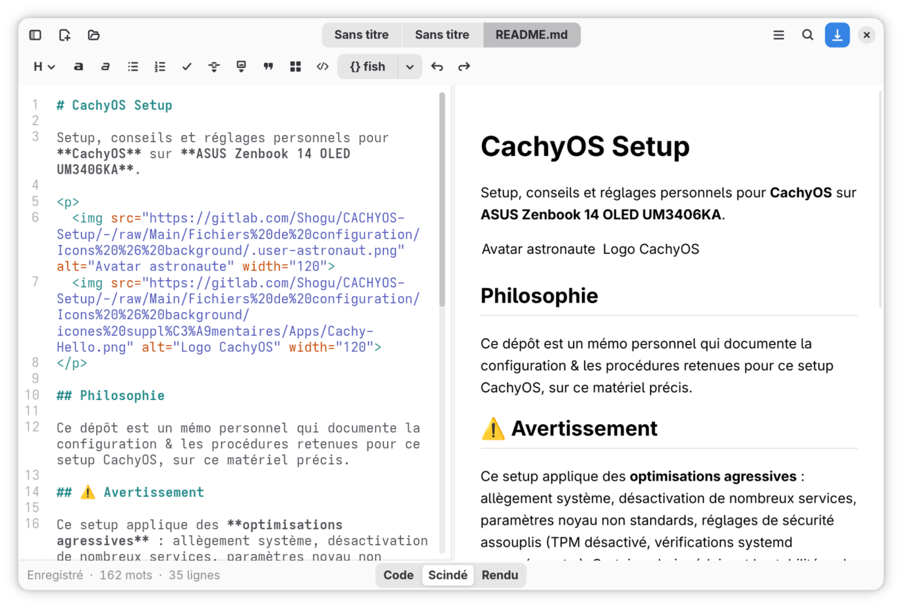
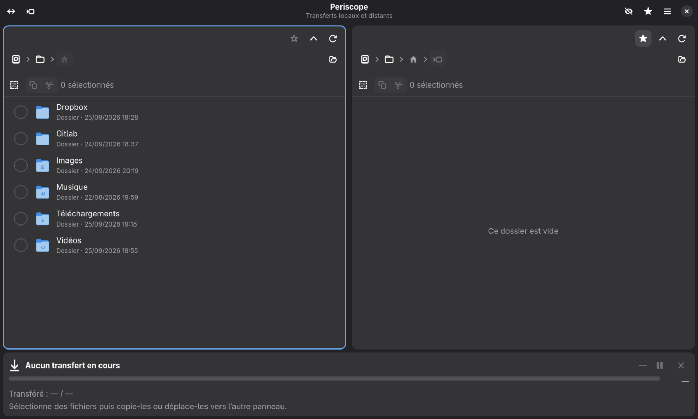
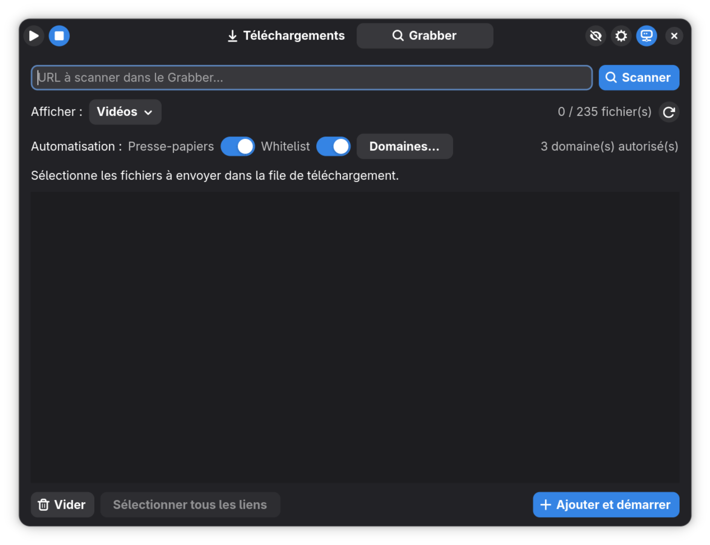
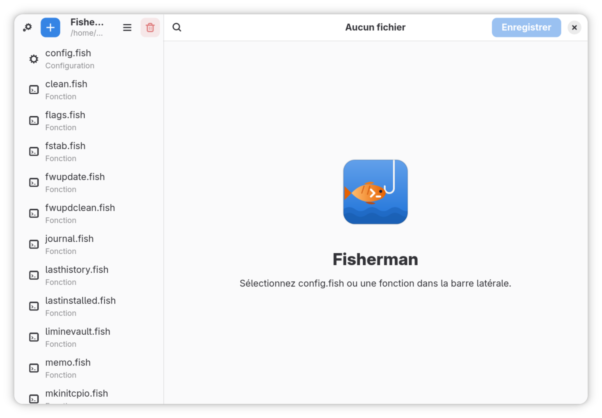
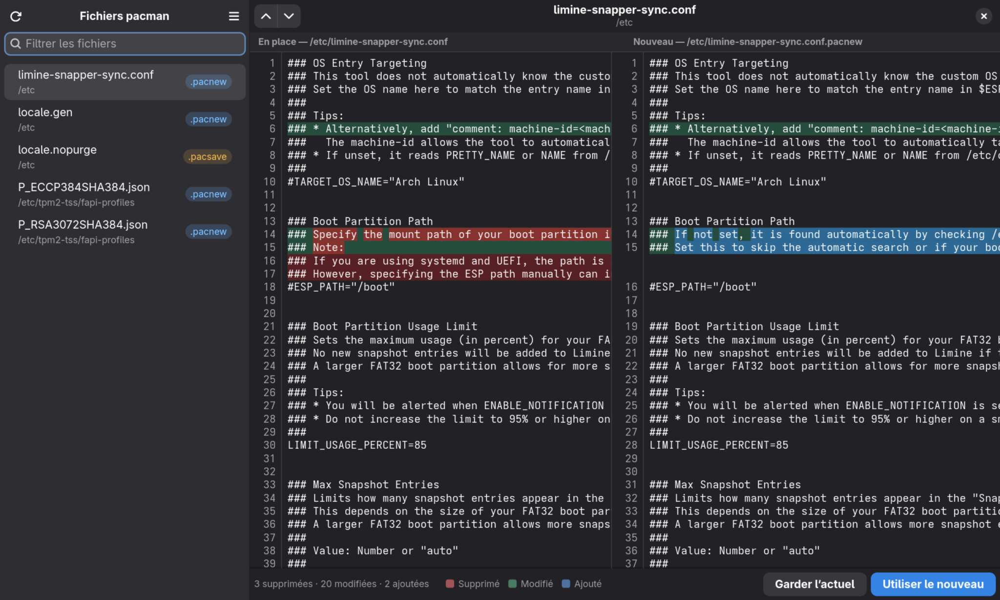
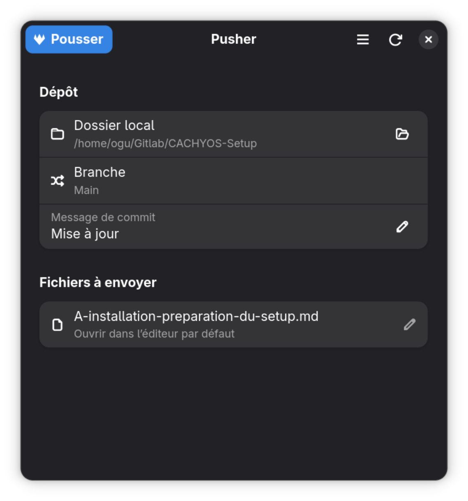
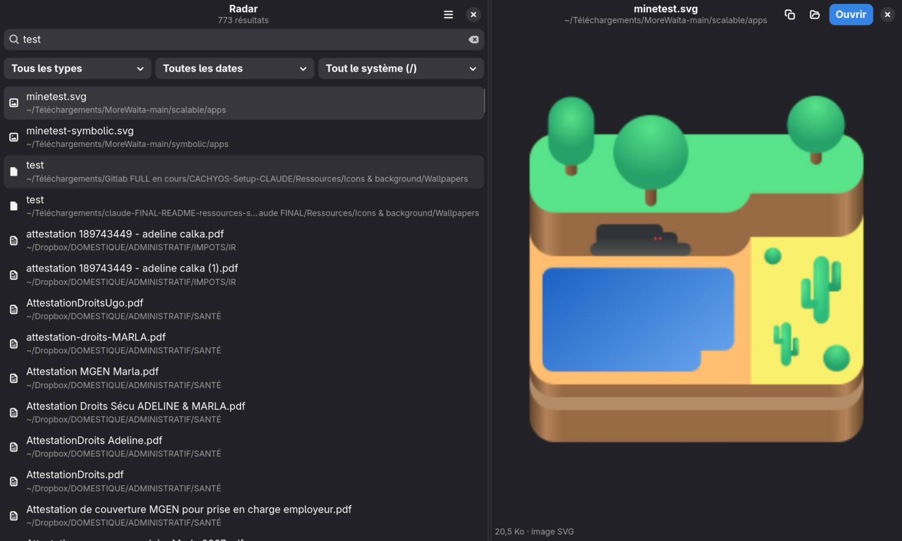
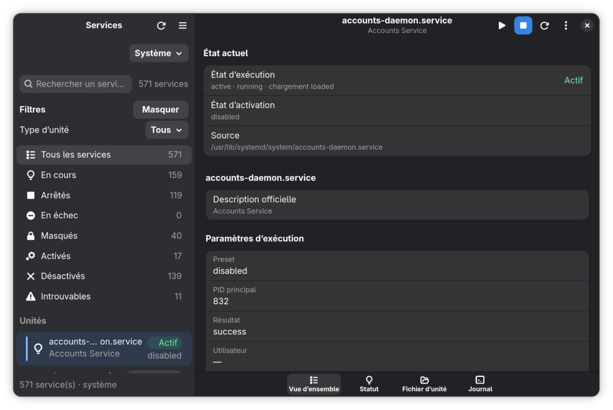

# 11 — Applications Vibe Coded

[Accueil](../README.md) · [Précédent](10-logiciels.md) · [Suivant](12-shell-terminal.md)

> **Dans ce chapitre :** applications personnelles développées avec l'aide du Vibe Coding, principalement en GTK4/libadwaita, dont le lecteur musical **Semitone** (fork de Gapless compilé avec Claude), le fork **Extension Manager**, les extensions GNOME maison « Always on top, always on top », **Session Keeper**, **Focus & Boutons**, **Power Total**, **UI Management** et le fork **Battery Time Compact — Ogu**, ainsi qu’un build GTK4 upstream utilisé par le setup.

**Compilation depuis les sources :** [Mail (`mail-postcard`)](10-logiciels.md#1014--messagerie--mail) est compilé avec **Claude** depuis Postcard, avec recherche et affichage des pièces jointes, aperçu des pièces jointes dans le panneau de droite (PDF, images, texte et documents Word/LibreOffice), vue à trois volets avec sélection multiple et menu au clic droit, et purge des copies locales à la fermeture, contraste entre panneaux et francisation complète. La base upstream est conservée ; le paquet est à ajouter manuellement dans `Ressources/Logiciels/Mail/`.

## Organisation des ressources

Les dossiers sont classés par usage principal. Les extensions GNOME Shell restent regroupées dans [Extensions GNOME](../Ressources/Applis%20vibe%20codées%20en%20Libadwaita/Extensions%20GNOME/).

- **01 — Multimédia** : Amplifaya, Decibel, Disquaire, Semitone.
- **02 — Bureautique et rédaction** : Alexandrie, Grimoire, Grille, Samizdat.
- **03 — Fichiers et téléchargements** : Fret, Grabber, Nautilus Bookmark Icons, PLACES, Thumbnailer Sushi.
- **04 — Bureau et personnalisation** : Extension Manager, Icônes UI.
- **05 — Système et utilitaires** : dconf-editor GTK4, Fisherman, Pacto, Pusher, Radar, Sismographe, Snapper GTK4, systemd-gui, Vidange.

## 01 — Multimédia

- [11.22 — Amplifaya — moteur headless et interface](#1122--amplifaya--moteur-headless-et-interface)
- [11.7 — Decibel](#117--decibel)
- [11.27 — Disquaire](#1127--disquaire)
- [11.29 — Semitone](#1129--semitone)

## 02 — Bureautique et rédaction

- [11.3 — Grimoire](#113--grimoire)
- [11.23 — Grille](#1123--grille)
- [11.24 — Samizdat](#1124--samizdat)
- [11.30 — Alexandrie](#1130--alexandrie)

## 03 — Fichiers et téléchargements

- [11.4 — Fret](#114--fret)
- [11.2 — Grabber](#112--grabber)
- [11.12 — Nautilus Bookmark Icons](#1112--nautilus-bookmark-icons)
- [11.26 — PLACES — Dossiers Ogu](#1126--places--dossiers-ogu)
- [11.31 — Thumbnailer Sushi](#1131--thumbnailer-sushi)

### 11.31 — Thumbnailer Sushi

**Thumbnailer Sushi 1.6.0-1** est un paquet Arch `any` vibe codé pour compléter **Sushi** et les miniatures GNOME, sans installer LibreOffice. Il cible CachyOS, GNOME 51 et Sushi 51.1.

- **Aperçus Sushi** : documents DOCX, ODT, RTF et Markdown ; présentations PPTX/ODP avec une carte par diapositive ; tableurs XLSX/ODS avec une vue GTK par feuille.
- **Archives** : ZIP, TAR et variantes compressées, 7z, RAR et paquets Arch `.pkg.tar.zst`, listés sans extraction.
- **Miniatures Nautilus** : documents, présentations, tableurs, texte brut et code, avec une apparence cohérente. Les archives conservent leur icône habituelle.
- **Sécurité** : conversion dans un processus Python séparé sans shell, contenu HTML avec CSP restrictive et JavaScript désactivé, ressources externes/locales bloquées dans l’aperçu, archives non extraites.

Le rendu est destiné à la consultation rapide : les mises en page complexes, les images de diapositives, la mise en forme des tableurs et les formats Office binaires anciens (`.doc`, `.xls`, `.ppt`) ne sont pas pris en charge.

Le paquet compilé sera ajouté manuellement dans [le dossier Thumbnailer Sushi](../Ressources/Applis%20vibe%20codées%20en%20Libadwaita/03-Fichiers-et-telechargements/Thumbnailer%20Sushi/). Son [README détaillé](../Ressources/Applis%20vibe%20codées%20en%20Libadwaita/03-Fichiers-et-telechargements/Thumbnailer%20Sushi/README.md) donne les instructions d’installation, les dépendances, les limites, le dépannage et l’état des tests.

Pour l’utilisation dans le workflow Nautilus, voir [9.7 — Aperçu et miniatures avec Sushi](09-nautilus-workflow.md#97--aperçu-et-miniatures-avec-sushi).

---

## 04 — Bureau et personnalisation

- [11.21 — Extension Manager](#1121--extension-manager)
- [11.25 — Icônes UI](#1125--icônes-ui)

## 05 — Système et utilitaires

- [11.28 — Vidange](#1128--vidange)
- [11.15 — dconf-editor GTK4](#1115--dconf-editor-gtk4)
- [11.8 — Fisherman](#118--fisherman)
- [11.9 — Pacto](#119--pacto)
- [11.11 — Pusher](#1111--pusher)
- [11.10 — Radar](#1110--radar)
- [11.6 — systemd](#116--systemd)
- [11.13 — Sismographe](#1113--sismographe)
- [11.14 — Snapper GTK4](#1114--snapper-gtk4)

## Extensions GNOME Shell

- [11.1 — Always on top, always on top](#111--always-on-top-always-on-top)
- [11.16 — Session Keeper](#1116--session-keeper)
- [11.17 — Focus & Boutons](#1117--focus--boutons)
- [11.18 — Battery Time Compact — Ogu](#1118--battery-time-compact--ogu)
- [11.19 — Power Total](#1119--power-total)
- [11.20 — UI Management](#1120--ui-management)

## 01 — Multimédia

### 11.22 — Amplifaya — moteur audio PipeWire

**Amplifaya 0.5.1** est un moteur audio PipeWire basé sur le cœur DSP de JamesDSP, sans interface graphique au démarrage et sans Qt. Le profil ClearPenguin est chargé par défaut ; une interface GTK4/libadwaita reste disponible à la demande avec `amplifaya-gui`.

Depuis la 0.5.0, PipeWire charge directement le traitement et WirePlumber insère le filtre devant la sortie audio. Le démon `amplifayad` et le service utilisateur `amplifaya.service` ont été supprimés. La commande `amplifayactl` pilote directement le traitement et conserve son état dans `~/.config/amplifaya/state.conf`.

La 0.5.1 ajoute la bascule automatique vers le son natif lors de la détection d’un casque, puis le retour du traitement sur les haut-parleurs, sans service séparé. La marge avant traitement est réglable de 0 à 6 dB (0 par défaut). La détection de la prise jack physique reste à vérifier en session réelle.

Commandes principales : `amplifayactl status`, `test`, `ab`, `bypass on|off`, `bass on|off`, `wide on|off`, `marge 0…6`, `presets` et `preset NOM`. Lance un morceau pendant `test` ou `ab`. Désactive JamesDSP ou EasyEffects pour éviter un double traitement.

**Mise à jour depuis 0.4.x :** mets la musique en pause, installe le nouveau paquet, désactive l’ancien service s’il existe, puis redémarre PipeWire et WirePlumber. La version 0.4.0 pouvait forcer la carte son à 100 % : baisse le volume avant de reprendre la lecture.

```fish
sudo pacman -U ./amplifaya-full-0.5.1-1-x86_64.pkg.tar.zst
systemctl --user disable --now amplifaya.service 2>/dev/null
systemctl --user restart pipewire wireplumber pipewire-pulse
amplifayactl status
amplifayactl test
```

Le paquet moteur seul est `amplifaya-0.5.1-1-x86_64.pkg.tar.zst`. Le dépôt contient encore l’archive 0.4.0 ; ajoute manuellement le paquet 0.5.1 dans le dossier [Amplifaya](../Ressources/Applis%20vibe%20codées%20en%20Libadwaita/01-Multimedia/Amplifaya/).

- Le moteur utilise environ 2 Mo de mémoire ; l’interface environ 100 Mo lorsqu’elle est ouverte.
- Pas de Bluetooth ; tous les effets de JamesDSP ne sont pas repris.
- Documentation détaillée : [README d’Amplifaya](../Ressources/Applis%20vibe%20codées%20en%20Libadwaita/01-Multimedia/Amplifaya/readme_amplifaya.md).


### Vérification après installation

Lance un morceau (MP3 ou autre) et laisse-le jouer pendant toute la vérification. Ces commandes contrôlent le volume matériel, le volume de la sortie Amplifaya, la sortie par défaut, le journal du moteur et enfin le traitement audio réel :

```fish
pactl get-sink-volume alsa_output.pci-0000_63_00.6.analog-stereo
pactl get-sink-volume amplifaya
pactl get-default-sink
journalctl --user -u amplifaya -b --no-pager | grep carte
amplifayactl test
amplifayactl ab
```

Résultat attendu sur la configuration testée : la carte physique est à **100 %**, la sortie par défaut est `amplifaya`, le journal indique que la carte a été mise à 100 % et que le volume Amplifaya a été ajusté. `amplifayactl test` doit confirmer que le son est modifié. `amplifayactl ab` alterne quatre fois entre le traitement Amplifaya et le son d'origine, puis restaure l'état initial. Les noms de sink peuvent varier d'une machine à l'autre : si la carte physique n'a pas le nom indiqué, repère son nom exact avec `pactl list short sinks` et adapte la première commande.

L'interface est incluse dans ce même paquet et peut être ouverte à la demande :

```fish
amplifaya-gui
```

Commandes utiles : `amplifayactl test`, `amplifayactl ab`, `amplifayactl bypass on|off`, `amplifayactl bass on|off`, `amplifayactl wide on|off`, `amplifayactl outputs`, `amplifayactl output NOM`, `amplifayactl stop` et `amplifayactl start`. Journaux : `journalctl --user -u amplifaya.service -b`.

La documentation complète et l'historique des versions sont dans [le README Amplifaya](../Ressources/Applis%20vibe%20codées%20en%20Libadwaita/01-Multimedia/Amplifaya/readme_amplifaya.md).

### 11.7 — Decibel

Fork personnalisé de **Decibels**, le lecteur audio GNOME. Les modifications apportées permettent notamment de supprimer un titre avec `Suppr` et d'éviter l'ouverture d'une seconde fenêtre lorsqu'un fichier audio est ouvert pendant une lecture : le nouveau morceau remplace celui de la fenêtre existante.

**Paquet fourni : `decibel-49.6.1-1-any.pkg.tar.zst`.**

### Installation

```fish
sudo pacman -U ./decibel-49.6.1-1-any.pkg.tar.zst
```

### Désinstallation

```fish
sudo pacman -Rns decibel
```

### Capture

Une capture de l'interface de Decibel n'a pas été fournie dans cet envoi. Elle pourra être ajoutée sous `../Ressources/screenshots/vibe-coded/decibel.png`.

---

### 11.27 — Disquaire

**Disquaire 1.7.1** est un éditeur GTK4/libadwaita de tags MP3 et FLAC pour GNOME. Il conserve sept champs — artiste, titre, album, année, genre, pochette et paroles — et supprime les autres tags lors du nettoyage automatique ou à l’enregistrement.

La version documentée propose notamment le nettoyage automatique, la normalisation des dates et pochettes, la recherche globale avec index en cache, l’édition groupée, la mise en forme artiste/titre, la réserve de pochettes par genre, la recherche de paroles LRCLIB avec traitement en lot, la recherche floue de doublons, la conversion FLAC vers MP3 320 kb/s et l’annulation des dernières opérations.

Les modifications de pochette, la mise en forme et les valeurs récupérées en ligne sont enregistrées directement. Les modifications manuelles dans les champs restent en attente, signalées par un point bleu. Le nettoyage automatique peut être désactivé dans les préférences.

Le README complet de Disquaire décrit l’ensemble des fonctions, les raccourcis, les dépendances et la compilation.

**Installation du paquet 1.7.1** — le fichier `disquaire-1.7.1-1-any.pkg.tar.zst` doit être présent dans le dossier Disquaire :

~~~fish
sudo pacman -U "Ressources/Applis vibe codées en Libadwaita/01-Multimedia/Disquaire/disquaire-1.7.1-1-any.pkg.tar.zst"
~~~

Le dépôt contient encore l’archive 1.5.2 ; ajoutez le paquet 1.7.1 manuellement avant d’utiliser cette commande.

[Lire le README complet de Disquaire](../Ressources/Applis%20vibe%20codées%20en%20Libadwaita/01-Multimedia/Disquaire/README.md).


---

### 11.29 — Semitone

**Semitone** est un lecteur musical GTK4/libadwaita écrit en Vala, fork de [Gapless](https://gitlab.com/Lalaggi/semitone/-/tree/main) (dans la lignée de G4Music). Le fork est compilé avec **Claude** pour ce setup et remplace l’installation du paquet `gapless` depuis l’AUR.

Fonctions annoncées par le projet :

- Lecture sans blanc entre les morceaux (*gapless*) via GStreamer.
- Paroles synchronisées au format LRC, avec 13 fournisseurs.
- Égaliseur à six bandes et prise en charge de ReplayGain.
- Gestion des playlists et intégration MPRIS avec GNOME.

Le paquet Arch compilé n’est pas inclus pour le moment : il sera ajouté manuellement dans le dossier [Semitone](../Ressources/Applis%20vibe%20codées%20en%20Libadwaita/01-Multimedia/Semitone/), comme les autres paquets maison. Une fois le fichier `semitone-*.pkg.tar.zst` copié dans ce dossier, ouvrir un terminal dans ce dossier et installer le paquet :

```fish
set paquets_semitone (find . -maxdepth 1 -type f -name 'semitone*.pkg.tar.zst')
if test (count $paquets_semitone) -eq 1
    sudo pacman -U "$paquets_semitone[1]"
else
    echo 'Conserver un seul paquet Semitone dans ce dossier avant installation.''
end
```

Le README du dossier détaille les fonctions et l’installation. Aucune version précise du paquet n’est indiquée tant que l’archive compilée n’a pas été ajoutée.


---

## 02 — Bureautique et rédaction

### 11.3 — Grimoire

Éditeur Markdown local GTK4/libadwaita utilisant GtkSourceView 5 et WebKitGTK 6. Il permet de parcourir des dossiers de documents Markdown, éditer les fichiers et afficher leur rendu.

**Paquet fourni : `grimoire-ogu-0.2.0-10-x86_64.pkg.tar.zst`.**



### Installation

```fish
sudo pacman -U ./grimoire-ogu-0.2.0-10-x86_64.pkg.tar.zst
grimoire
```

> Si le copier-coller remplace le nom de commande, utiliser simplement `grimoire`.

### Désinstallation

```fish
sudo pacman -Rns grimoire-ogu
```

---

### 11.23 — Grille

**Grille** est une visionneuse simple de fichiers tableurs, codée avec **Claude**.

**Paquet : `grille-0.1.0-1-x86_64.pkg.tar.zst`.** Le paquet n’est pas encore présent dans le dépôt ; il est à ajouter manuellement dans [le dossier Grille](../Ressources/Applis%20vibe%20codées%20en%20Libadwaita/Grille/).

Depuis le dossier contenant le paquet :

```fish
sudo pacman -U ./grille-0.1.0-1-x86_64.pkg.tar.zst
```

Les formats pris en charge et la commande de lancement restent à préciser à partir du paquet ou de son README.

### 11.24 — Samizdat

**Samizdat 0.11.0** est un traitement de texte GNOME en Rust, GTK4/libadwaita, basé sur `letters-core` de gtk-office-suite. Il prend en charge DOCX, ODT, Markdown, texte brut, HTML et la lecture/export PDF. Les nouveautés documentées depuis 0.8.0 comprennent un aperçu paginé en direct, l’OCR français (images et PDF scannés), une règle graduée, des commandes de paragraphe plus compactes, la correction orthographique globale, un mode concentration amélioré et des corrections de sélection, de défilement et de copie sur clé USB.

### Nouveautés 0.8.1 à 0.11.0

- **Aperçu en direct** : panneau à droite, F12 pour l’afficher/masquer, rendu différé après la frappe, suivi de la page et du curseur, clic pour positionner le curseur et double-clic pour ouvrir l’outil d’une image, frise, tableau ou cartouche. Largeur mémorisée ; panneau masqué en mode concentration et dans les onglets PDF.
- **OCR en français** : Tesseract reconnaît le texte imprimé d’une image collée, d’un fichier image ou d’un PDF scanné. Le texte peut remplacer l’image collée, être inséré sous une image ou être copié depuis un onglet PDF. Les pages PDF sont traitées avec progression ; une opération OCR s’annule en un seul Ctrl+Z. L’écriture manuscrite et les documents complexes en plusieurs colonnes restent moins bien reconnus.
- **Règle graduée** : Ctrl+R, graduation tous les 0,25 cm, réglage du retrait du paragraphe et lignes repères verticales.
- **Paragraphes et orthographe** : style courant indiqué par l’icône ¶, retrait basculant, boutons dédiés d’alignement à gauche et de centrage ; « Corriger tout le document » applique la première suggestion après confirmation, avec une seule annulation.
- **Mode concentration et interface** : page blanche plein écran, ligne en cours centrée si l’option est activée, entrée/sortie sans perdre la position du curseur. Barre d’outils plus compacte, Annuler/Rétablir à gauche, boutons d’insertion regroupés dans « + » lorsque la fenêtre est étroite.
- **Préférences** : aperçu à droite au démarrage et bouton OCR masquable.
- **Corrections** : la sélection est conservée lors du changement de police, taille ou couleur ; le clic dans la page ne provoque plus de remontée intempestive ; les erreurs d’enregistrement expliquent la cause probable ; la copie sur clé USB passe par des fichiers préparés localement.

### Modèles fournis

Quatre modèles DOCX sont fournis dans l’archive `Modèles de cours en docx (Samizdat).tar.xz` :
- `Cours.docx`
- `Page de garde de séquence.docx`
- `Bac blanc Français.docx`
- `Bac blanc Histoire-Géographie.docx`

L’archive se trouve dans `Ressources/Applis vibe codées en Libadwaita/02-Bureautique-et-redaction/Samizdat/Modeles/`. Après extraction, importer les fichiers DOCX depuis les préférences (`Ctrl+,`). Ils ne sont pas importés automatiquement.

### Installation

Depuis le dossier contenant le paquet compilé, installer l’archive Samizdat. Le nom exact du fichier dépend de la release ajoutée manuellement ; vérifier qu’un seul paquet correspond au motif :

```fish
sudo pacman -U ./samizdat-*.pkg.tar.zst
```

Les dépendances OCR `tesseract` et `tesseract-data-fra` sont installées automatiquement par pacman si elles sont déclarées dans le paquet.

Le [README complet de Samizdat](../Ressources/Applis%20vibe%20codées%20en%20Libadwaita/02-Bureautique-et-redaction/Samizdat/README.md) récapitule les fonctions, raccourcis et limites connues. Le paquet Arch compilé n’est pas encore présent dans le dossier : il sera ajouté manuellement.


### 11.30 — Alexandrie

**Alexandrie** est une visionneuse simple de Wikipédia en français pour GNOME, développée en GTK 4/libadwaita. Elle est conçue pour préparer des cours d'histoire, de géographie et de littérature : lecture épurée d'articles, collecte d'extraits et export de fiches PDF.

- **Lecture** : onglets, sommaire latéral, aperçu des liens au survol, recherche dans l'article et historique.
- **Repères et lieux** : dates clés extraites de Wikidata (vie, œuvres, événements, fonctions), carte OpenStreetMap et ouverture des lieux cités dans GNOME Cartes.
- **Panier d'extraits** : passages, images, dates, consignes et glossaire ; documents numérotés, à copier dans un traitement de texte ou à exporter en PDF.
- **Favoris** : classement par tags libres.
- **Sources** : Wikipédia (« Encyclopédie »), Vikidia (8–13 ans), Wikisource (« Textes ») et Wikimedia Commons (« Images »). Le Wiktionnaire s'ouvre au double-clic ; les articles proposent aussi « Voir aussi ».

### Installation et lancement

Depuis le dossier des sources, sur Arch Linux ou CachyOS :

```sh
makepkg -si
```

Ou installer le paquet précompilé, une fois ajouté au dossier de l'application :

```sh
sudo pacman -U ./alexandrie-*.pkg.tar.*
```

Vérifier qu'un seul paquet correspond au motif avant l'installation. Pour essayer l'application sans l'installer, depuis les sources :

```sh
./run.sh
```

Le guide complet `docs/GUIDE.md` est fourni avec les sources et couvre les fonctionnalités, raccourcis, préférences et données utilisateur. Les sources et le guide détaillé ne sont pas encore copiés dans ce dépôt ; le paquet compilé sera ajouté manuellement dans `Ressources/Applis vibe codées en Libadwaita/02-Bureautique-et-redaction/Alexandrie/`.

---

## 03 — Fichiers et téléchargements

### 11.4 — Fret

Gestionnaire de fichiers GTK4/libadwaita à deux panneaux, inspiré de Nautilus. Chaque panneau peut afficher un emplacement local ou une URI GVfs telle que FTP, SFTP ou SMB. Les transferts sont effectués directement entre les deux panneaux.

**Paquet fourni : `fret-0.2.0-1-any.pkg.tar.zst`.**



### Installation

```fish
sudo pacman -U ./fret-0.2.0-1-any.pkg.tar.zst
```


Pour SMB, installer au besoin :

```fish
sudo pacman -S --needed gvfs-smb
```

### Désinstallation

```fish
sudo pacman -Rns fret
```

---

### 11.2 — Grabber

Frontend GTK4/libadwaita minimaliste pour JDownloader 2. Il permet de récupérer des liens, sélectionner les fichiers utiles, les ajouter à la file de téléchargement et suivre les téléchargements. L'AppImage embarque son propre Java et JDownloader.

**AppImage fournie : `grabber.AppImage`.**



### Installation

Rendre l'AppImage exécutable puis la lancer :

```fish
chmod +x ./grabber.AppImage
./grabber.AppImage
```

Les données persistantes de JDownloader sont conservées dans `~/.local/share/jd-adwaita/jdownloader`.

### Désinstallation

Supprimer l'AppImage. Pour supprimer également les données persistantes de JDownloader :

```fish
rm -rf "$HOME/.local/share/jd-adwaita/jdownloader"
```


Penser à régler son icone avec Menu!

---

### 11.12 — Nautilus Bookmark Icons

Petite extension `nautilus-python` pour Nautilus 48–50 permettant de personnaliser l’icône des favoris de la barre latérale. Elle est dérivée du mécanisme de **Nautilus My Computer**, mais ne reprend aucune de ses autres fonctions.

**Paquet fourni : `nautilus-bookmark-icons-0.1.1-1-any.pkg.tar.zst`.**

### Installation

Depuis la racine du dépôt :

```fish
sudo pacman -U "Ressources/Applis vibe codées en Libadwaita/03-Fichiers-et-telechargements/Nautilus Bookmark Icons/nautilus-bookmark-icons-0.1.1-1-any.pkg.tar.zst"
nautilus -q
```

Rouvrir Nautilus puis utiliser **clic droit sur un favori → Changer l’icône**. Le choix est conservé via GSettings ; **Réinitialiser** restaure l’icône native.

### Désinstallation

```fish
sudo pacman -Rns nautilus-bookmark-icons
nautilus -q
```

La sidebar de Nautilus n’étant pas couverte par une API d’extension officielle, une future version majeure peut nécessiter une adaptation.

---

### 11.26 — PLACES — Dossiers Ogu

**Dossiers Ogu** est le gestionnaire personnel d’icônes et de dossiers, distinct d’**Icônes UI**, qui ne gère que les icônes des applications installées. L’application regroupe dans un fichier Python autonome le plan des dossiers, leurs icônes et les dossiers à masquer.

### Fonctions

- choisir une icône parmi les vignettes, ou revenir à l’icône standard de Fichiers ;
- ajouter ou retirer une ligne du plan ;
- importer des icônes, renommées selon la convention du gestionnaire ;
- créer les dossiers manquants et appliquer les icônes ;
- masquer les dossiers cochés en les renommant avec un point initial, puis mettre à jour `~/.config/user-dirs.dirs` ;
- restaurer l’état antérieur à la dernière application ;
- exporter un nouvel `.pyz` autonome avec le plan et les icônes à jour ;
- relancer Nautilus pour actualiser l’affichage.

Les dossiers Dropbox ne sont pas créés par l’application : attendre que Dropbox ait terminé sa synchronisation avant de lancer l’outil.

### Lancement

Depuis le dossier contenant `dossiers-ogu.pyz` :

```fish
python3 dossiers-ogu.pyz
```

Python 3, GTK4 et PyGObject sont nécessaires. Sur CachyOS GNOME, ils sont normalement déjà présents ; sinon :

```fish
sudo pacman -S python-gobject gtk4
```

Les icônes utilisées et le fichier `correspondances.txt` sont documentés dans le [LISEZMOI du gestionnaire](../Ressources/Applis%20vibe%20codées%20en%20Libadwaita/PLACES/LISEZMOI-dossiers.md). Le fichier `dossiers-ogu.pyz` et le tableau de correspondances sont à conserver dans le dossier PLACES du dépôt.

---

## 04 — Bureau et personnalisation

### 11.21 — Extension Manager

Fork de l’application **Extension Manager** de Matt Jakeman, enrichi avec l’aide du Vibe Coding. Interface native **GTK4/libadwaita**, paquet Arch **x86_64** `extension-manager-ogu`, version **0.6.5.ogu2-1**.

### Fonctions

- classement automatique des extensions installées dans sept catégories ;
- changement de catégorie par le menu de chaque extension, avec mémorisation et retour au classement automatique ;
- extensions système conservées dans un groupe séparé ;
- icône personnalisée Ogu ;
- panneau **Parcourir** et recherche repris de l’application originelle, sans filtre supplémentaire GNOME N+1/N−1.

### Installation

Depuis la racine du dépôt :

```fish
sudo pacman -U "Ressources/Applis vibe codées en Libadwaita/04-Bureau-et-personnalisation/Extension Manager/extension-manager-ogu-0.6.5.ogu2-1-x86_64.pkg.tar.zst"
```

Si la version des dépôts `extension-manager` est installée, accepter son remplacement proposé par pacman. Le paquet local s’appelle `extension-manager-ogu`, fournit `extension-manager` et entre en conflit avec la version des dépôts.

Fermer complètement l’ancienne instance, puis lancer l’application :

```fish
extension-manager
```

### Désinstallation

```fish
sudo pacman -R extension-manager-ogu
```

Le [README du dossier Extension Manager](../Ressources/Applis%20vibe%20codées%20en%20Libadwaita/Extension%20Manager/readme_extension-manager.md) détaille les fonctions, les dépendances et le retour à la version des dépôts. Voir aussi [le classement dans le chapitre Extensions GNOME](08-gnome-extensions.md#811--classer-les-extensions-avec-extension-manager).

Archive, métadonnées, exécutable, lanceur et icônes contrôlés. **Lancement et recherche en session GNOME réelle non testés lors de cette intégration.** Le paquet joint est conservé à l’identique ; aucun paquet de sources supplémentaire n’est ajouté.

---

### Captures d'écran restantes

Les captures fournies avec cette mise à jour couvrent **Always on top, Grabber, Grimoire, Fret, systemd, Pacto, Radar et Pusher**. Les trois applications suivantes restent volontairement sans capture afin de ne pas fabriquer une représentation de leur interface : **Decibel et Fisherman**.

### 11.25 — Icônes UI

**Icônes UI** est une petite application Python/GTK4 issue du vibe coding pour gérer les icônes **des applications installées**. Elle présente l’icône actuelle et celle proposée, en couleur et en symbolique ; permet de modifier/importer les icônes, appliquer les changements avec possibilité de restauration, rétablir les lanceurs faits main manquants, et exporter un nouvel `.pyz` qui conserve les imports.

### Lancement

Depuis le dossier contenant le fichier :

```fish
python3 icones-ogu.pyz
```

Dépendances éventuelles :

```fish
sudo pacman -S python-gobject gtk4
```

L’outil Icônes UI et le gestionnaire d’icônes des dossiers personnels sont deux applications distinctes. Voir [11.26 — PLACES / Dossiers Ogu](#1126--places--dossiers-ogu) pour le second.

---

## 05 — Système et utilitaires

### 11.28 — Vidange

**Vidange** est une application GTK4/libadwaita en Python pour nettoyer CachyOS sous GNOME 51. Elle centralise les tâches d'entretien dans une fenêtre, estime l'espace récupérable avant le nettoyage et affiche un récapitulatif final.

- **Paquets orphelins** : trois niveaux, des orphelins classiques (`pacman -Qtdq`) aux dépendances utilisées uniquement entre elles et aux paquets explicitement installés qui ne sont utilisés par aucun autre paquet.
- **Cache pacman** : garder deux versions, retirer les versions désinstallées ou vider entièrement le cache.
- **Cache AUR** : Shelly, yay et paru ; journaux systemd avec taille réglable ; miniatures et corbeille ; caches pip, npm, yarn et Go ; profils navigateurs via `profile-cleaner`.
- Chaque catégorie présente une estimation avant action. « Tout nettoyer » enchaîne les catégories de nettoyage et récapitule les résultats.
- Les vues des dépendances entre orphelins et des paquets explicitement installés sont des **vues de vérification** : rien n'est coché par défaut et elles ne sont pas incluses dans « Tout nettoyer ».

Vidange remplace la fonction Fish `clean` et le paquet AUR `archclean`. Elle ne cherche volontairement pas les gros fichiers.

**Sécurité :** l'application ne tourne jamais en root. Les opérations système passent par `/usr/lib/vidange/vidange-helper`, lancé via `pkexec` et Polkit. Le helper n'accepte qu'une liste fermée d'actions, valide les paramètres et exécute les commandes sans shell. Les tâches bloquantes sont exécutées en arrière-plan pour préserver la réactivité de l'interface.

Le paquet Arch compilé sera ajouté manuellement dans [le dossier Vidange](../Ressources/Applis%20vibe%20codées%20en%20Libadwaita/05-Systeme-et-utilitaires/Vidange/). Son [README](../Ressources/Applis%20vibe%20codées%20en%20Libadwaita/05-Systeme-et-utilitaires/Vidange/README.md) donne les instructions d'installation et les dépendances ; le `CLAUDE.md` du dossier conserve les détails techniques du helper.

---

### 11.15 — dconf-editor GTK4

Le **dconf-editor GTK4** utilisé dans ce setup est une exception dans ce chapitre : il ne s’agit **pas d’une application vibe codée**, mais d’un build compilé depuis les **sources officielles du portage GTK4 en cours**.

Il remplace la version GTK3 fournie par les dépôts. Avant l’installation du build GTK4, supprimer donc le paquet GTK3 :

```fish
sudo pacman -Rns dconf-editor
```

Le build GTK4 est ensuite compilé et installé depuis les sources upstream officielles utilisées par le setup. Cette séparation évite de documenter le portage officiel comme un fork maison et empêche la commande générale d’installation des logiciels de réinstaller accidentellement le paquet GTK3.


---

### 11.8 — Fisherman



Gestionnaire graphique minimaliste des fichiers de configuration de Fish, notamment `config.fish` et les fonctions Fish.

**Paquet fourni : `fisherman-0.1.8-2-any.pkg.tar.zst`.**

### Installation

```fish
sudo pacman -U ./fisherman-0.1.8-2-any.pkg.tar.zst
```

### Désinstallation

```fish
sudo pacman -Rns fisherman
```

### Capture

Une capture de l'interface de Fisherman n'a pas été fournie dans cet envoi. Elle pourra être ajoutée sous `../Ressources/screenshots/vibe-coded/fisherman.png`.

---

### 11.9 — Pacto

Application GTK4/libadwaita destinée à la gestion des fichiers `.pacnew` et `.pacsave` : collecte, tri, comparaison, édition, remplacement et suppression.

**Paquet fourni : `pacto-1.0.0-1-any.pkg.tar.zst`.**



### Installation

```fish
sudo pacman -U ./pacto-1.0.0-1-any.pkg.tar.zst
```

### Désinstallation

```fish
sudo pacman -Rns pacto
```

---

### 11.11 — Pusher

Application GTK4/libadwaita minimaliste destinée à la gestion graphique du dépôt GitLab personnel. Elle regroupe les opérations courantes autour du dépôt local et de son envoi vers le dépôt distant.

**Paquet fourni : `pusher-1.7.0-1-any.pkg.tar.zst`.**



### Installation

```fish
sudo pacman -U ./pusher-1.7.0-1-any.pkg.tar.zst
```

### Désinstallation

```fish
sudo pacman -Rns pusher
```

---

### 11.10 — Radar

Application GTK4/libadwaita de recherche et de visualisation de fichiers, avec moteur de recherche floue maison, filtres et aperçu de nombreux formats. La version 1.6.0 ajoute notamment l'aperçu des tableaux ODS/XLSX, le contenu des archives sans extraction et l'ouverture via l'application par défaut.

Le paquet radar-1.6.0-1-any.pkg.tar.zst est à ajouter manuellement au dossier Radar.



### Installation

```fish
sudo pacman -U ./radar-1.6.0-1-any.pkg.tar.zst
```

### Désinstallation

```fish
sudo pacman -Rns radar
```

---

---

### 11.6 — systemd



Frontend GTK4/libadwaita pour l'administration graphique des services systemd. L'application utilise `systemctl` et `journalctl` comme sources de vérité et permet notamment de rechercher les services, consulter leur état, leur unité et leur journal, et effectuer les actions courantes.

**Paquet fourni : `systemd-gui-0.4.0-5-any.pkg.tar.zst`.**


### Installation

```fish
sudo pacman -U ./systemd-gui-0.4.0-5-any.pkg.tar.zst
```

L'application ne doit pas être lancée avec `sudo`.

### Désinstallation

```fish
sudo pacman -Rns systemd-gui
```

---

### 11.13 — Sismographe

Application GTK4/libadwaita de diagnostic du système GNOME. Elle regroupe les vues Santé, Journaux, Démarrage et Stockage : erreurs par service, plantages, analyse du boot, état SMART, compteurs d’erreurs btrfs et contrôle FAT. Elle permet d’exporter un rapport texte. Les opérations privilégiées passent par polkit ; les outils de stockage sont optionnels.

Depuis la racine du dépôt, installer le paquet fourni :

```fish
sudo pacman -U "Ressources/Applis vibe codées en Libadwaita/05-Systeme-et-utilitaires/Sismographe/sismographe-1.0.0-1-any.pkg.tar.zst"
sismographe
```

Pour les diagnostics de stockage optionnels :

```fish
sudo pacman -Syu --needed smartmontools btrfs-progs dosfstools
```

Désinstallation :

```fish
sudo pacman -Rns sismographe
```

Le paquet fourni et son contenu ont été inspectés ; les diagnostics restent à tester sur la machine cible.

---

### 11.14 — Snapper GTK4

Frontend GTK4/libadwaita pour **Snapper** et l’intégration **Limine**. L’application reprend les opérations du workflow Snapper/Limine dans une interface GNOME native : affichage des snapshots, informations Avant/Après, création, suppression, restauration et réglages de nettoyage automatique.

Le cœur de la restauration n’est pas réimplémenté dans l’interface : Snapper GTK4 s’appuie sur les outils système Snapper/Limine et utilise un helper privilégié via Polkit pour les opérations qui nécessitent les droits administrateur.

**Paquet natif courant du setup : `snapper-gtk4-1.4.0-5-any.pkg.tar.zst`.**

### Fonctions principales

- affichage et filtrage des snapshots, notamment **Tous / Avant / Après** ;
- création et suppression de snapshots ;
- restauration à partir d’un snapshot via le workflow Limine/Snapper ;
- réglage des nettoyages `number`, `timeline` et des paires Avant/Après vides ;
- activation ou désactivation des minuteurs systemd Snapper correspondants ;
- lancement manuel du nettoyage selon les limites enregistrées.

### Installation

```fish
sudo pacman -U ./snapper-gtk4-1.4.0-5-any.pkg.tar.zst
```

L’application se lance ensuite sans `sudo` :

```fish
snapper-gtk4
```

### Désinstallation

```fish
sudo pacman -Rns snapper-gtk4
```

---

## Extensions GNOME Shell

### 11.1 — Always on top, always on top

Extension GNOME Shell minimaliste ajoutant une icône dans la barre supérieure pour activer ou désactiver le mode natif **Toujours au premier plan** de la fenêtre active.

L'extension est compatible GNOME Shell 45 à 50, sans dépendance ni panneau de préférences.


### Installation

Depuis le dossier contenant l'extension :

```fish
gnome-extensions install --force "always-on-top-always-on-top_localhost.shell-extension.zip"
gnome-extensions enable always-on-top-always-on-top@localhost
```

Sous X11, recharger GNOME Shell avec `Alt+F2`, puis `r`. Sous Wayland, se déconnecter puis se reconnecter.

### Désinstallation

```fish
gnome-extensions uninstall always-on-top-always-on-top@localhost
```

---

### 11.16 — Session Keeper

Extension GNOME Shell de productivité destinée à sauvegarder automatiquement la session et à restaurer rapidement les applications et fenêtres après une reconnexion ou un redémarrage.

Cette version part de **Session Keeper 1.0.6 d’ALT Linux** et a été adaptée pour **GNOME 50**. Le moteur reste entièrement natif GNOME/Linux : GJS, Mutter, Gio et GLib, sans daemon ni outil externe.

**Paquet Arch fourni :** `gnome-shell-extension-session-keeper-1.2.2-1-any.pkg.tar.zst`. UUID : `session-keeper@altlinux.org`.

### Fonctions principales

- sauvegarde événementielle différée, sans polling, avec écriture atomique ;
- restauration déclenchée dès que GNOME a terminé son démarrage, sans délai fixe inutile ;
- lancement rapide des applications avec faible échelonnement ;
- restauration de plusieurs fenêtres par application lorsque l’application le permet ;
- appariement renforcé des fenêtres ;
- restauration de la position, taille, espace de travail et écran ;
- restauration des états maximisé, plein écran, minimisé, toujours au-dessus et tous les espaces de travail ;
- filtrage des dialogues et des fenêtres non relançables ;
- sauvegarde finale synchrone lors d’une fermeture GNOME propre ;
- panneau de préférences permettant d’activer ou désactiver les principales fonctions avancées ;
- interface et textes en français.

Le fichier `metadata.json` contient aussi le mot-clé `productivity` afin que **Manager Extensions** classe automatiquement l’extension dans **Productivité**, sans règle spéciale basée sur son UUID.

### Installation

Depuis la racine du dépôt, installer le paquet Arch fourni :

```fish
sudo pacman -U "./Ressources/Applis vibe codées en Libadwaita/Extensions GNOME/Session Keeper/gnome-shell-extension-session-keeper-1.2.2-1-any.pkg.tar.zst"
```

Sous Wayland, se déconnecter puis se reconnecter, puis activer l’extension :

```fish
gnome-extensions enable session-keeper@altlinux.org
```

Ouvrir les réglages :

```fish
gnome-extensions prefs session-keeper@altlinux.org
```

### Désinstallation

```fish
gnome-extensions uninstall session-keeper@altlinux.org
```

### Limite

Session Keeper restaure les applications et leurs fenêtres, mais pas leur contenu interne arbitraire. La restauration des onglets, documents ou sessions internes dépend donc de chaque application.

Le [README du dossier Session Keeper](../Ressources/Applis%20vibe%20codées%20en%20Libadwaita/Extensions%20GNOME/Session%20Keeper/readme_session-keeper.md) résume l’installation et les fonctions.

---

### 11.17 — Focus & Boutons

Extension GNOME Shell maison dédiée à la rationalisation de **Quick Settings** et du panneau **Calendrier/Notifications**. Compatible GNOME Shell **50 et 51**.

**Version documentée : v25.** UUID : `focus-et-boutons@ogu`. Le ZIP v25 doit être ajouté manuellement au dépôt dans `Ressources/Applis vibe codées en Libadwaita/Extensions GNOME/Focus & Boutons/`.

### Fonctions principales

- fermeture automatique de Quick Settings lorsque le pointeur en sort, après un délai réglable de 100 à 2000 ms, 350 ms par défaut ;
- même comportement pour le panneau Calendrier/Notifications ;
- masquage optionnel du bouton Capture d’écran ;
- bouton **Réglages scindé** : clic principal vers Paramètres GNOME ; chevron vers Ajustements, Éditeur dconf et Extensions Manager ;
- bouton **Power scindé** : clic principal vers le dialogue Éteindre ; chevron vers Suspendre, Redémarrer, Reconnexion et Verrouiller la session ;
- coloration **bleu Adwaita temporaire** des deux boutons scindés tant que leur sous-menu est ouvert ;
- renommage optionnel du profil de puissance en **Énergie** ;
- retrait du cadenas séparé quand le bouton Power scindé est actif ;
- masquage optionnel de la liste des sorties audio et de son chevron ; la sortie par défaut reste utilisée ;
- carte des rendez-vous dans la couleur d’accent du système (bleu par défaut), sans modifier la date ni ajouter de bordure ;
- masquage optionnel de la grande zone Notifications lorsqu’elle est vide ;
- préférences GSettings appliquées immédiatement.

L’extension ne modifie ni le volume ni le microphone. Elle peut masquer le sélecteur de sortie audio, mais ne change pas la sortie par défaut.

### Changements techniques récents

**v22 — Appel de l’OSD et journalisation**
- Essaie plusieurs signatures d’appel de l’OSD de GNOME Shell, mémorise la forme qui fonctionne et l’écrit dans le journal.
- Enregistre une fois au chargement la définition de la fonction OSD réellement présente dans GNOME Shell, utile pour diagnostiquer une incompatibilité si les trois formes échouent.
- Limite l’échec à une seule erreur de journal au lieu de répéter le message en boucle.

**v25 — Liste des rendez-vous adaptative**
- La liste prend la hauteur nécessaire à son contenu : pas de grand espace vide quand il y a peu de rendez-vous.
- Elle grandit jusqu’à **300 px** ; au-delà, son contenu défile.
- Le fondu de bord reste à **14 px**.

**Tests :** la v25 n’a pas pu être testée ici. Le comportement adaptatif est donc à vérifier en session GNOME réelle.

### Installation

Depuis le dossier contenant le ZIP v25 :

```fish
gnome-extensions install --force ./Focus-et-Boutons-v25.zip
gnome-extensions enable focus-et-boutons@ogu
```

Préférences :

```fish
gnome-extensions prefs focus-et-boutons@ogu
```

Sous Wayland, fermer puis rouvrir la session après remplacement d’une version déjà chargée.

### Désinstallation

```fish
gnome-extensions uninstall focus-et-boutons@ogu
```

Le [README du dossier Focus & Boutons](../Ressources/Applis%20vibe%20codées%20en%20Libadwaita/Extensions%20GNOME/Focus%20%26%20Boutons/readme_focus-et-boutons.md) récapitule les fonctions et l’installation.

---

### 11.18 — Battery Time Compact — Ogu

Fork personnel de **Battery Time (Percentage) Compact** pour GNOME Shell **50 et 51**. Le UUID upstream est conservé afin de remplacer directement l’extension d’origine.

**Archive fournie : `Battery-Time-Compact-Ogu-v54.zip`.** UUID : `batterytimepercentagecompact@sagrland.de`.

### Affichage

- **Top bar** : `9:27 - 56%` — autonomie restante puis pourcentage, sans parenthèses ;
- **Quick Settings** : `9:27 - 4.2 W` — autonomie restante puis puissance instantanée, sans répétition du pourcentage.

La puissance vient de `UPower.Device.EnergyRate`. La v54 réapplique l’affichage après chaque synchronisation UPower afin d’éviter que GNOME remette temporairement le pourcentage natif dans Quick Settings lorsque seule la puissance varie.

### Installation

```fish
gnome-extensions install --force "Ressources/Applis vibe codées en Libadwaita/Extensions GNOME/Battery Time Compact Ogu/Battery-Time-Compact-Ogu-v54.zip"
gnome-extensions enable batterytimepercentagecompact@sagrland.de
```

### Désinstallation

Réinstaller l’archive upstream pour revenir au comportement d’origine, ou désinstaller l’extension :

```fish
gnome-extensions uninstall batterytimepercentagecompact@sagrland.de
```

Le [README du dossier Battery Time Compact — Ogu](../Ressources/Applis%20vibe%20codées%20en%20Libadwaita/Extensions%20GNOME/Battery%20Time%20Compact%20Ogu/readme_battery-time-compact-ogu.md) décrit le fork.

---

### 11.19 — Power Total

Extension GNOME Shell **50** fusionnant **Auto Power Profile** et **Power Switching Manager**. Version **0.1.1**, archive **Power-Total.zip**, UUID `power-total@ogu`. Catégorie dans Extension Manager Ogu : **Système et énergie**.

### Fonctions

- profils d’alimentation sur secteur/batterie et profils par application ;
- mémorisation optionnelle des changements manuels, économie à batterie faible et protection expérimentale contre un chargeur insuffisant ;
- luminosité de l’écran, thème clair/sombre et rétroéclairage du clavier selon l’alimentation ;
- préférences Libadwaita en français, modules indépendants et import des anciens réglages.

Par défaut, seul le changement de profil est activé : **Performance sur secteur**, **Équilibré sur batterie**. Aucun daemon supplémentaire n’est installé. Le service énergétique existant applique les profils ; les autres fonctions dépendent des capacités de GNOME et du matériel.

### Installation

Depuis la racine du dépôt, installer l’archive :

```fish
gnome-extensions install --force "Ressources/Applis vibe codées en Libadwaita/Extensions GNOME/Power Total/Power-Total.zip"
```

Se déconnecter puis se reconnecter à GNOME. Désactiver les deux anciennes extensions avant d’activer Power Total :

```fish
gnome-extensions disable auto-power-profile@dmy3k.github.io
gnome-extensions disable power-switching-manager@joseruibarros.com
gnome-extensions enable power-total@ogu
gnome-extensions prefs power-total@ogu
```

Si une ancienne extension n’est pas installée, sa commande de désactivation peut signaler qu’elle est introuvable. Le bouton **Importer** des préférences permet de récupérer ses réglages personnalisés ; les modules supplémentaires restent à activer séparément.

### Désinstallation

```fish
gnome-extensions disable power-total@ogu
gnome-extensions uninstall power-total@ogu
```

Le [README du dossier Power Total](../Ressources/Applis%20vibe%20codées%20en%20Libadwaita/Extensions%20GNOME/Power%20Total/readme_power-total.md) détaille les réglages et la migration. Voir aussi [Extensions GNOME — Power Total](08-gnome-extensions.md#89--power-total) et [coordination des profils avec TuneD/SCX](05-performance-tuning.md#51--coordonner-tuned-les-profils-énergétiques-et-scx).

Syntaxe, schémas et tests avec services simulés contrôlés ; **fonctionnement en session GNOME réelle restant à vérifier**. Le ZIP inclut les sources et les licences d’origine.

---

### 11.20 — UI Management

Extension GNOME Shell maison regroupant les fonctions du setup auparavant réparties entre **Just Perfection**, **AutoActivities**, **Hot Edge** et **Quick Close Overview**.

Nom final : **UI Management**. Catégorie Extension Manager : **Bureau et fenêtres**. La description utilisée pour la reconnaissance de catégorie contient **« Gestion du bureau et des fenêtres »**. La version de travail produite est **UI Management 1**, ciblée pour **GNOME Shell 49, 50 et 51**.

### Organisation des préférences

- **Visibilité** — options issues de Just Perfection réellement utilisées ;
- **Comportement** — comportements Shell retenus ;
- **Personnaliser** — réglages visuels conservés ;
- **Automatisation** — fonctions Auto Activities et Hot Edge ;
- **Quick Close in Overview** reste activable indépendamment dans l’interface.

### Extensions remplacées

Ne plus installer séparément dans ce setup :

- Just Perfection ;
- AutoActivities ;
- Hot Edge ;
- Quick Close Overview / Middle Click to Close in Overview.

Le but est de réduire le nombre d’extensions et les points de maintenance tout en gardant les fonctions choisies. **UI Management ne remplace pas Focus & Boutons, Power Total, Session Keeper ni **, qui restent des extensions spécialisées séparées.

L’archive produite lors du développement est nommée **`UI-Management-1.zip`**. L’UUID exact n’a pas été consigné dans la documentation de référence ; il n’est donc pas inventé ici.

Le [README du dossier UI Management](../Ressources/Applis%20vibe%20codées%20en%20Libadwaita/Extensions%20GNOME/UI%20Management/readme_ui-management.md) récapitule la fusion.

---
